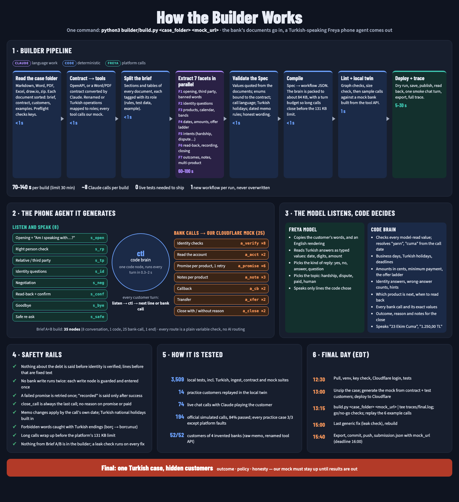
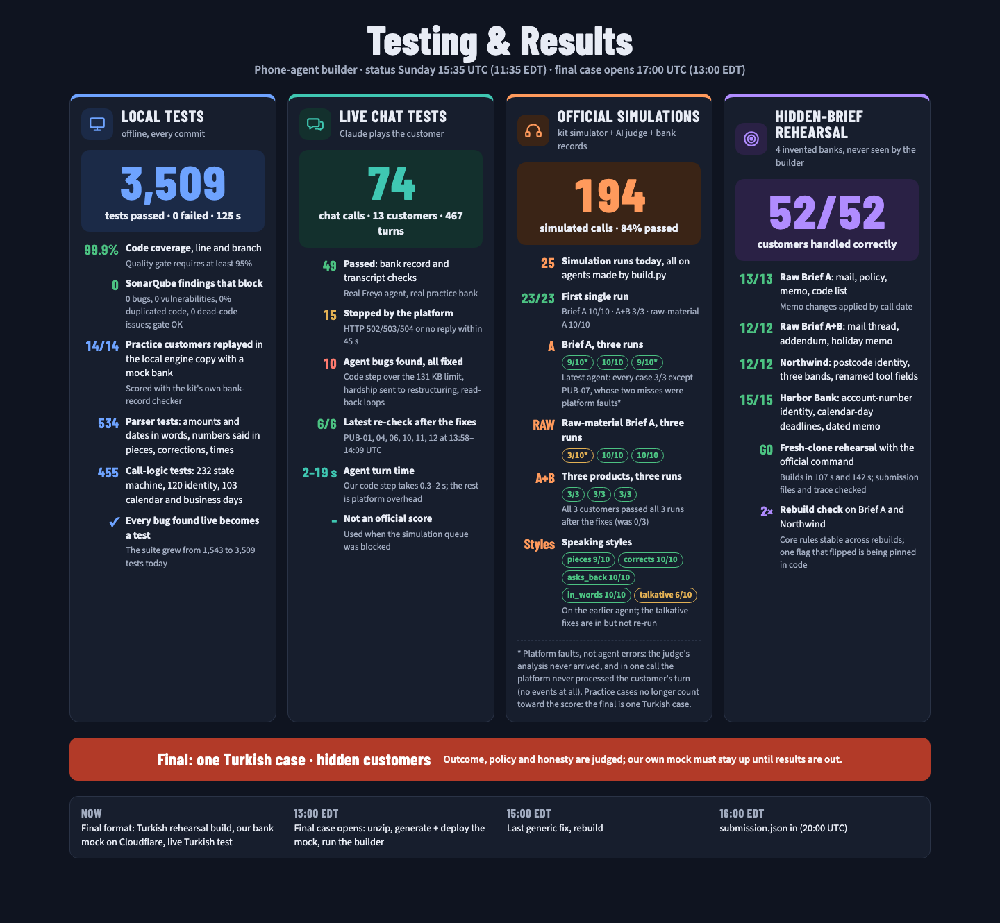

# Freya × YC "Build the Builder"

A **builder** that reads a bank's documents and creates a Freya **phone agent** for debt-collection calls, with no
manual step.



## The final (Sun 11 Oct 2026, 13:00–16:00 EDT = 17:00–20:00 UTC)

- **One case, in Turkish:** Freya Bank's credit-card statement-debt line (*ekstre borcu*). One phone agent is submitted.
- **Input:** a zip with a folder of the bank's documents (Markdown, Word, PDF, Excel): `BRIEF.md`, `README.md`,
  analysis, a flow drawing, announcements, the **service contract**, **test customers**, Q&A, and 6 example
  conversations.
- **Our own bank mock:** we host it on **Cloudflare Workers** (Workers Paid), built from the service
  contract and the test customers. The agent's tools call it during scoring, so it must **stay up until the results are out**.
- **Official command:** `python3 builder/build.py {case_folder} {mock_url}`.
- **Scoring:** hidden simulated customers. A call is judged on its outcome (the right promise recorded once), on policy
  and on honesty (never say "recorded" when the tool call failed). The trace is not scored, but a reviewer reads it.
- **Rule:** nothing from the final case may be written into the builder after 17:00 UTC. Generic bug fixes are allowed.

For repository-based submissions, configure `SUBMISSION_REPO` and `SUBMISSION_BRANCH` for your own repository.

Step-by-step for the final: **[docs/RUNBOOK.md](docs/RUNBOOK.md)**.

## Quick start

```bash
python3 -m venv .venv && . .venv/bin/activate && pip install -r requirements.txt   # python3 inside the venv has the deps
cp kit/env.example kit/env.sh   # FREYA_API_KEY=fak_...; never commit env.sh
set -a; . kit/env.sh; set +a
claude          # log in once (the builder's model client is the Claude Agent SDK), or export ANTHROPIC_API_KEY
npx wrangler login   # Cloudflare, for the mock
```

### Final flow (exact commands in the runbook)
1. **Unzip** the case outside `builder/`, for example into `final/<CaseFolder>/`.
2. **Mock:** turn the service contract into the OpenAPI the agent will call (`python -m builder.contract <case> <mock_url> --out mock/openapi.json`).
   Then generate the mock's data from it and from the test customers (`tools/mockgen/make_config.py`), deploy with
   `tools/mockgen/deploy.sh`, and check it with `tools/mockgen/smoke.py <mock_url>`.
3. **Build:** `python3 builder/build.py final/<CaseFolder> <mock_url> 2>&1 | tee traces/final.log`.
4. **Check:**
   - the trace shows exit 0, lint with 0 errors, the twin passing and the smoke turn ok;
   - the Spec is in Turkish, and its outcomes and enums match the contract;
   - replay the 6 example conversations.
5. **Submit:** export the workflow, commit the workflow and trace, push, and send `submission.json` (team, members, repo, commit,
   run_command, workflow, trace, **mock_url**) before 16:00 EDT.

## How it works

**The phone model listens; code decides.**
- **Builder (≈70–140 s):**
  1. Read the case folder.
  2. Turn the service contract into tools that call our mock.
  3. Claude extracts a typed **Spec** in 7 parallel facets.
  4. Validate it: values quoted from the documents, enums bound to the contract, call language, holidays, dated memo
     rules, honest wording.
  5. A deterministic compiler builds the workflow.
  6. Lint, then the local twin.
  7. Deploy, publish, read back, one smoke chat turn, and a full trace.
- **Phone agent:** a hub of 8 listen-and-speak nodes, around one packed code node (`ctl`, the call brain), around
  engine-fired bank-call nodes. The Freya model only reads the customer: their words, an English rendering, typed
  values (date, digits, amount) and the kind of reply. Code decides everything else:
  - dates and business days, Turkish holidays and deadlines;
  - amounts in cents, the minimum payment and the offer ladder;
  - identity counts;
  - every bank call and its exact values;
  - the outcome, reason and notes;
  - every line the agent says (Turkish dates "23 Ekim Cuma" and amounts "1.250,00 TL").

| Path | What it is |
|---|---|
| `builder/` | `build.py` (CLI, stages, trace) · `ingest.py` (case folder: md/docx/xlsx/pdf/drawio/zip) · `contract.py` (service contract → tools, role mapping) · `pipeline/` (segment, extract, validate, critic) · `compiler/` (graph, render, snippet, lint) · `calendars/` (Turkish public holidays 2026–27) · `prompts/` · `spec/` |
| `runtime/` | The call brain packed into the code node: `brain.py`, `parse.py`, `ident.py`, `cal.py`, `locale.py`, `bundle.py` (stdlib only, ≤ 90 KB packed) |
| `mock/` + `tools/mockgen/` | Cloudflare Worker bank mock (config-driven, KV ledger, `/health`, `/ledger/<id>`, `/reset/<id>`) and its generator, deploy script and smoke check |
| `harness/` | Local twin of the Freya engine plus a mock bank; live chat end-to-end runner |
| `tools/` | `quality.sh` (tests, coverage ≥ 95%, vulture, SonarQube), `submit.py`, `leak_check.py`, `gonogo.py`, `run_official.sh` |
| `testbed/` | Rehearsal cases: `tr-final/` (a Turkish case folder shaped like the final), `raw-a`, `raw-ab`, `mut-c`, `mut-d` |
| `kit/` | The official kit v3, unchanged |
| `docs/` | Design, runbook, knowledge base, edge cases, findings (below) |

## Results so far



- **Local:** 3,509 tests pass, 0 fail. Coverage 99.9%. SonarQube gate OK: 0 bugs, 0 vulnerabilities, 0% duplicated
  code, 0 dead-code issues.
- **Official kit simulations** (simulated customer + AI judge + bank records), latest agents:
  - **Brief A:** every case passed all 3 runs except PUB-07. Both of its misses were platform faults: no judge verdict,
    and one turn the platform never processed.
  - **Brief A+B:** **3/3 with all 3 runs passing**.
  - **Raw-material Brief A:** 10/10 twice.
  - Totals: 194 simulated calls, 84% passed. The early failures are fixed, with regression tests.
- **Hidden-brief rehearsal:** 52/52 customers across 4 invented banks (raw memo with dated rules, renamed tool API,
  other identity fields and calendars).
- **Turkish final readiness:** case-folder ingest, contract → tools, Turkish understanding and speech, Turkish
  forbidden-word endings, national holidays, the long-call turn cap and the Cloudflare mock are all built and unit-tested.
  An end-to-end Turkish rehearsal is in progress (see `docs/STATUS.md`).

## Things we learned the hard way

- **Freya `code_exec` limit:** it refuses a run when the code plus the call's variable data is over **131,072 bytes**. The data grows
  each customer turn, by about 470 B in English and more in Turkish. So the brain is packed (deflate + base64), and
  the agent wraps up before the limit instead of going silent.
- **No `{{` or `}}` in code** and no `null` anywhere in a workflow. Booleans arrive as `"true"`/`"True"` strings. Never
  write `""` to an enum extraction variable (the platform rejects it).
- **Chat API:** the opening line is not spoken (the customer speaks first). The turn that ends the call returns
  502/504; the reply can be recovered from `GET /call/{id}?workspaceId=`.
- **Judge strictness:** "this call is recorded" in the opening was read as claiming a recording too early, so we say "we
  record this call". Offers must be made once; re-asks are neutral.
- **Speech:** dates said with no punctuation, numbers in pieces, small talk and corrections are the main sources of
  errors. Model-read typed values plus code validation handle them, and they are the only option for Turkish.
- **Platform load:** simulations can queue for minutes and judges can time out. Run `--reps 3` before trusting a score.

## Docs

| Doc | What it holds |
|---|---|
| [docs/RUNBOOK.md](docs/RUNBOOK.md) | Exact steps for the final |
| [docs/STATUS.md](docs/STATUS.md) | What works, round by round, with numbers |
| [docs/SYSTEM-DESIGN.md](docs/SYSTEM-DESIGN.md) | Full design: Spec, compiler, agent graph, testing, risks |
| [docs/CONTRACTS.md](docs/CONTRACTS.md) | Interfaces between builder, runtime, compiler and harness |
| [docs/FEATURES.md](docs/FEATURES.md) | The feature list (P0/P1/P2) |
| [docs/edge-cases/EDGE-CASES.md](docs/edge-cases/EDGE-CASES.md) | 806 edge cases audited against the design |
| [docs/knowledge/00-INDEX.md](docs/knowledge/00-INDEX.md) | Verified knowledge base of the kit: workflow engine, tools, API, bank, briefs, cases |
| [docs/FREYA-PUBLIC-API-FINDINGS.md](docs/FREYA-PUBLIC-API-FINDINGS.md) | What the public Freya API docs add or contradict |
| [docs/img/](docs/img/) | The two graphics (PNG + HTML) |

## Rebuild (for the organisers)

```bash
python3 -m venv .venv && . .venv/bin/activate && pip install -r requirements.txt
export FREYA_API_KEY=fak_...            # your workspace; FREYA_API_URL defaults to staging-app.freyavoice.ai
claude                                   # or export ANTHROPIC_API_KEY (builder model: claude-opus-5-5)
python3 builder/build.py {case_folder} {mock_url} 2>&1 | tee traces/final.log
```

- **Preflight:** a missing package, key or Claude login stops the run within a second with exit 2 and a fix-it message.
- **Phone agent model:** the Freya default set in `kit/freya.py`, the same for every team.
- **Workflows:** without `--slot`, every run creates its own workflow (`<case>-<hash>-<UTC time>`), so no run can
  overwrite an agent an earlier trace describes.
- **Exit codes:** 0 ok, 1 internal, 2 input or preflight, 3 Spec invalid, 4 lint, 5 deploy, 6 budget.
- **Trace:** every stdout line is a trace event: START (argv, commit, start time), MODEL (each Claude call: purpose,
  model, effort, seconds), SPEC, DECISION, VALIDATE, LINT, TWIN, FREYA (workflow id, agent id, nodes, tools, smoke turn),
  END and SUMMARY. API keys are scrubbed from every line.

Never commit `kit/env.sh`, `state/` or any `fak_` / `sk-ant-` key.
