# System design: "Deterministic Spine v3" builder

Status: final design for discussion, Sat 2026-10-10 ~22:30 UTC, after the red-team round (platform-truth, hidden-brief-attack, reliability, ops). No code yet. No Freya key yet. The pre-red-team version is kept at `design/candidates/SYSTEM-DESIGN-v2-pre-redteam.md`.

Origin: this design starts from the top-ranked candidate, **reliability** (24.2 of 30 points across three judges). It adds the parts of **compiler** (22.6), **generalisation** (20.7) and **hybrid-agentic** (16.1) that survived judging. Section 2.3 maps each judged flaw to its fix. Section 2.4 maps every red-team issue (critical, major, and the minor ones folded in) to its resolution. Section 15 lists what is accepted as a known limitation.

Evidence labels used throughout:

| Label | Meaning |
|---|---|
| **[VER]** | "verified in a working builder" in the kit docs |
| **[DOC]** | stated in the kit docs, not verified |
| **[SEEN]** | "seen in a trial call / in tests, not guaranteed" |
| **[CODE]** | read from kit code (`freya.py`, `run_cases.py`, `score.py`) |
| **[PROBED-earlier]** | from the earlier mock-bank probes (bank routes only, no Freya routes) |
| **[INFERRED]** | our inference, not stated anywhere |
| **[E-n]** | needs live experiment n (section 12). Each has a fallback that changes a template or a compile flag, not the architecture |

Citations:

| Short | File |
|---|---|
| WF | `kit/build-the-builder/docs/workflow-format.md` |
| TC | `docs/tools-and-code.md` |
| API | `docs/api.md` |
| OAS | `tools/openapi.json` |
| SC / RC / FP | `tools/score.py` / `tools/run_cases.py` / `freya.py` |
| A / B | `briefs/brief-a.md` / `briefs/brief-b.md` |
| HP | `research/hackathon-page.md` (§Submit, §Rules) |
| ERR | `knowledge/_corrections-and-uncertainties.md`, cited as `ERR <section> <id>`, e.g. `ERR tc-2 K1` |

All line numbers refer to those files. Platform claims that changed in this revision were re-checked against the docs on 2026-10-10 (list in §2.5).

---

## 1. Goals and non-goals

### 1.1 Goals, in priority order

1. **3/3 reliability on unseen rules.** A case counts only if all 3 runs pass both the exact ledger check (SC:17-34) and the judge's policy and honesty checks (HP §Final). With 0.97 per run, a case passes 3/3 with probability 0.91. Every decision that a rule can settle is therefore made by code, not by the phone model.
2. **Read the brief, do not know it.** The builder must handle:
   - a clean spec;
   - raw bank material (mail + policy extract + amending memo + code list);
   - a changed OpenAPI file (same 7 tool names; other fields, field names, formats and enums);
   - 1-3 products per customer;
   - several calendar days, so `now` varies, and memo rules can take effect between `now` and a deadline.
3. **Human speech.** Numbers in two parts, self-corrections, decoy dates, questions back, chatter, amounts, dates and codes in words (RC:27-32 styles `pieces`, `corrects`, `talkative`, `asks_back`, `in_words`).
4. **Rules and verification.**
   - One command, `python3 builder/build.py {brief_path} {tool_api_path}` (HP §Submit). It creates the agent with no manual step and finishes in ≤ 30 min including self-tests.
   - A complete, honest trace that a reviewer agent can match to the code.
   - Nothing from a hidden brief may be written into the builder.
   - The organisers' rebuild must reproduce our score.
5. **Tie-breaks.**
   - The largest legitimate promised amount: the brief's first ask first, floor only when the rules allow it.
   - A short build time. Planning target ≤ 12 min clean, ≤ 15 min raw; **re-planned from real timed calls at CP0/CP1** (§8.4).
   - Early submission: target ≤ 19:00 UTC, hard stop 19:40.

### 1.2 Non-goals

- **No model-callable bank tools, no `matches_intent`, no global nodes, no `loop_condition`, no `context_variables` in the generated agent.** Every one of these has documented uncertainty: ERR wf-1 U1/U2, wf-2 U1/U10, tc-1 U5, WF:244-277.
- **No Freya simulations inside a build.** Hidden briefs have no practice customers; one simulation per workspace; 3-11 min per 10 cases.
- **No agentic (Agent SDK) editing of the agent at build time.** It would make the organisers' rebuild nondeterministic. Claude is used only through fixed, versioned, structured-output calls.
- **No tuning to Brief A or B.** Their values live only in `testbed/` and `tests/`; the leakage lint enforces it.
- **No mock-bank tunnel for live tests.** A tool call to any host other than the kit's tool API fails the case.
- **No parallel hidden builds by default** (D6). The tie-break counts total build time, so parallelism does not help it.

---

## 2. Architecture overview and design principles

### 2.1 Pipeline (builder) and runtime (agent)

```mermaid
flowchart LR
  B["brief.md"]
  O["tool API file (JSON/YAML, detected by content)"]
  O --> TC["openapi_model: ToolCatalog + roles + success predicates + wire formats (code)"]
  B --> SEG["ingest/segment: sections, tables, lexicon (code)"]
  SEG --> DM["docmap (1 LLM, ALWAYS; also warms the prompt cache)"]
  DM --> CONS["consolidate (1 LLM, if >1 document or any amending document)"]
  DM --> RA["Route A: claims, 6 facets, quote + op + key + effective_from (6 LLM)"]
  CONS --> RB["Route B: facet extraction on consolidated/clean text (6 LLM)"]
  RB --> QV2["quote + derivability verify (code)"]
  QV2 --> SB["Spec B"]
  SB --> FV["FIRST VIABLE: bind, validate, compile, L0-L2, L3 deploy+publish, export (code)"]
  RA --> QV["quote + derivability verify, keyed overrides (code)"]
  QV --> SA["Spec A"]
  SA --> DIFF["leaf diff (code)"]
  SB --> DIFF
  DIFF --> ADJ["adjudicate disputed leaves (0-6 LLM)"]
  ADJ --> BIND["bind: wire_value_source, code lists, ApiRefs (code, 0-1 LLM)"]
  TC --> BIND
  BIND --> VAL["validate + defaults policy (code)"]
  VAL --> CRIT["critic: residual rules, speech vs flow (1 LLM)"]
  VAL --> ORA["oracle cross-check (1 LLM + runtime)"]
  CRIT --> REP{"errors?"}
  ORA --> REP
  REP -- "yes, at most 1 round" --> REPAIR["repair (1 LLM)"]
  REPAIR --> VAL
  REP -- "no" --> CMP["compiler (code)"]
  CMP --> L0["L0 lint + invariants"] --> L1["L1 runtime checks"] --> L2["L2 twin + mock bank"]
  L2 --> DEP["L3 deploy: dry run, save, publish, projected read-back diff"]
  DEP --> L4["L4 chat smoke (no bank calls, time-capped)"]
  L4 --> EXP["export to runs/slot/run_id/"]
  TR[["trace.py: every stage, every model call, to stdout AND file"]] -.-> EXP
```



The first-viable deploy (§3, `build.py`) guarantees that a run-made, published agent exists by about T+8 min even if a later stage crashes or the budget runs out. The full pipeline then republishes the same workflow from the same run.

At call time, the generated agent runs one fixed loop per customer turn:

```text
customer message
   v  (listen node s_*: 1 extraction call -> u_act, u_topic, u_text, slots; no dialogue reply expected)
 [s_*] --always--> [ctl code node]
                      | 1. ctl_failure_count > 1                      -> s_fail (fixed apology -> close)   [E10]
                      | 2. nx = a_W AND r_a_W_s = pending (guard)       -> write chain a_W -> a_W' -> ... -> s_bye | ctl
                      | 3. nx = X                                       -> listen s_* (tts {{say}}) | q_* | read api node -> ctl
                      | 4. always                                       -> s_safe (fixed re-ask, compile-time text)
 s_bye (tts results + required sentences + goodbye) -> a_close_r | a_close_n | a_close_lit -> e_end (silent hang-up)
```

### 2.2 Design principles

| # | Principle |
|---|---|
| P1 | **The phone model senses; code decides.** experimental-5 fills two small per-stage enums (`u_act`, `u_topic`), a verbatim copy of the last message, and a few verbatim slot phrases. Code makes everything else: routing, every tool call and argument, dates, amounts, counts, outcome, reason, notes and every policy sentence. |
| P2 | **Deterministic routing only.** Every transition is `equals`/`is_set`/`greater_than` on engine- or code-written variables (with AND groups, WF:331-366), or `always`. No routing model call (WF:13-36, WF:407). |
| P3 | **Fixed speech where policy is at stake.** Before verification every line is fixed tts. After verification there is free text only in fenced `q_*` nodes, used for real questions only. |
| P4 | **Engine-fired, unrolled bank calls, never entered twice.** Each call happens in its own `api_request` node with a body baked from code-written variables (TC:78-95). No write node is entered twice: `ctl` state forbids it, and an engine-side guard on every transition into a write node (`r_<node>_s equals pending`, §6.3) blocks re-entry from a stale `nx` even if `ctl` crashed. |
| P5 | **No reliance on contested features on the main path.** No hooks (ERR tc-2 U22), no lifecycle model-fill (ERR tc-2 K1), no global nodes or `matches_intent`. Contested features appear only behind compile flags, after an experiment. |
| P6 | **The brief is data.** The Spec is a typed IR; compiler and runtime are generic. A new brief changes the Spec, never the code. |
| P7 | **Every LLM output is checked by something independent.** Quotes against the source, values derivable from quotes, enums against the OpenAPI file, two routes diffed, an oracle, a critic. Unresolved items become logged defaults, never silent guesses. |
| P8 | **Test locally; spend live slots on what only live tests can show.** |
| P9 | **Always ship something, from this run.** First-viable deploy at ~T+8 min; every LLM call is bounded by the remaining budget; the hard cap exports the last published version. |
| P10 | **Every run is its own evidence.** Each run gets its own workflow, run directory and trace file; nothing a rerun does can overwrite an earlier run's agent or trace (§9). |

### 2.3 How each judged flaw (round 1) is fixed

| Flaw (judges) | Fix in this design |
|---|---|
| Thin raw-material handling (reliability) | Segmentation + lexicon in code, docmap, claims with `{doc, quote, op, key, effective_from}`, quote + derivability verification, keyed overrides in code, code-list binding with `wire_value_source`, critic + classified residual rules, two-route check (§5) |
| Extractor scheduled too late (reliability) | Own track from Sat 22:30; golden Specs reproduced by CP3 (§11) |
| No formula escape hatch (reliability) | Closed `DateRule`/`AmountRule`/predicate vocabularies, then whitelisted **Expr** with an extended function set (§4.4) |
| No hang-up safety (reliability, hybrid) | Node close primary; optional node-level lifecycle net on post-`ctl` listen nodes only, E5-gated, off for hidden builds unless E5 also clears abandoned chats (§6.6, D1) |
| Re-bake dependency (reliability, compiler) | Unrolled write nodes + engine-side entry guards (§6.3) |
| Blanket `min_confidence` (reliability, generalisation) | Per-field-class values, calibrated in E4; code grounding of slots in `u_text` (§6.5) |
| Unverified passthrough tts and code re-entry (reliability) | E1/E2 first night, sized to the worst chain; `ctl=chain` (K copies), deterministic write chaining, `s_pass` fold (§6.8, §12) |
| Lint missing for same-target merge (reliability) | Lint: the `always` target is never also an `equals` target; no duplicate targets per node (WF:408) |
| Lifecycle close + pre-hook as primary (compiler, generalisation) | Rejected as primary (§6.6) |
| "temperature 0" (compiler) | Removed (Opus 5.5 returns 400). Reproducibility from schema, two routes, adjudication, deterministic compiler, measured drift |
| Large `c_neg` extraction schema (compiler) | Two small enums per stage (`u_act` ≤ 8, `u_topic` ≤ 12, split if larger) + ≤ 4 slots (§6.5) |
| Phrasebook LLM variance (generalisation) | Verbatim lines copied, content lines written once and linted; generic templates in code |
| Hooks on pre_actions (generalisation, compiler) | None on the main path |
| In-build simulations, agentic loop (hybrid) | Dropped; invariant gate and oracle kept |
| Pre-verification free text (hybrid) | None; canned lines, disclosure-lexicon lint (§6.4) |
| Chat smoke overstated (generalisation, compiler) | L4 is short, time-capped, never fails the ship on transport errors (§8.3) |

### 2.4 Red-team round 2: resolution index

IDs: **PT** platform-truth, **HB** hidden-brief-attack, **RL** reliability, **OP** ops. "Accepted" items have a residual risk in §15.

| ID | Sev | Issue (short) | Resolution | Where |
|---|---|---|---|---|
| PT1 | crit | ctl crash/timeout leaves stale `nx` → re-entered write node or loop | First statement of the snippet writes `nx='s_safe'` and a fixed re-ask; real writes last, `nx` very last. Engine-side guards on every write-node transition. `ctl_failure_count > 1 → s_fail` (E10-gated). Twin fault plan "ctl crash/timeout at every phase"; invariant I13 | §6.2, §6.3, §7.16, §8.3, §12 E10 |
| PT2 | maj | `ctl=ab` does not survive long chains | Write nodes chain directly (`wn_*` + guard); happy-path confirm turn enters `ctl` once. Fallback `ctl=chain` emits K distinct copies, K = static hop bound (lint I16). E1 sized to the worst chain | §6.3, §6.8, §12 E1 |
| PT3 / RL8 | maj | Possible extra dialogue reply after a tts listen node; no task_message | Workflow `system_prompt` with no-disclosure rules; defensive `task_message` on every listen node; flag `speak=llm_echo`; E1 pass criterion "exactly one assistant message per customer turn" + L2/T7 transcript lint | §6.2, §6.8, §12 |
| PT4 | maj | Extractor can copy the agent's own offer into `u_date`/`u_amt` | Grounding: a slot is used only if its value tokens occur in `u_text`; `suppress_tool_results: true` on all api nodes; agent-offer-then-refusal turns in E4 and the twin noise plan | §6.5, §7.10 |
| PT5 | maj | In-place slot update lets a rerun overwrite an earlier run's agent | Default slot is unique per run: `<stem>-<sha8(brief+api)>-<UTC YYYYmmddTHHMMSS>` → own workflow per run; `select_run.py` re-checks the version before submission | §3, §9.2 |
| PT6 / OP1 | maj/crit | Shared unlocked state file; parallel builds; same-stem collision | Per-slot state file `state/<slot>.json` + `fcntl.flock`; slot includes content hash; deploy asserts the exported `workflow_id` is the one this run created; L4 serialised by a lock file; builds sequential by default | §3, §9.2, D6 |
| PT7 | maj | Full structural read-back diff fails on platform normalisation; hidden `success:false` | Projected-subset diff, extra keys ignored; deploy calls `freya.api` directly and fails on any `success:false` | §8.3 L3 |
| PT8 | maj | Experiments assumed chat writes to the practice ledger | 2-minute U14 check first; ledger-dependent experiments run as one-case simulations with a custom cases file; chat only for E2/E4/E8 | §12 |
| PT9 | min | q_* fence in `on_enter.prompt` | Fence moved to `task_message` (verified path, TC:466) | §6.4 |
| PT10 / RL13 | min | `max_node_turns` cannot fire; I11 gave false assurance | Turn budgets enforced in `ctl` state; `max_node_turns` 80 + `max_turn_transition → ctl` kept as boilerplate; I11 reworded | §6.2, §8.3 |
| PT11 | min | URL lint literally wrong | `url == servers[0].url + catalog path`, method from the catalog | §8.3 |
| PT12 | min | Lifecycle net on `s_open` fires with unresolved `co`/`cr` | Net never attached to `s_open`; attached only to nodes entered after the first `ctl` pass | §6.6 |
| PT13 | min | L4 "turn 1 equals opening" | Prefix + banned-word checks; expectations from E8 | §8.3 |
| PT14 / OP5 | min/maj | `fallbacks:"default"` needs a beta header; unpinned SDK | Beta header sent; request shape smoke-tested at CP0; pinned versions; fallback-served facets re-run once on primary | §3 `llm.py`, §9.3 |
| HB1 | crit | Code list vs no-enum field; composite codes | `wire_value_source` decision per bank-facing field; composite code rows bind `(outcome, reason)` pairs; CONFLICT trace line; T4 mutant | §4.5, §5.2 step 8 |
| HB2 | crit | Renamed success/verify response fields | `success` role is a predicate (`bool_true`/`enum_in`/`http_ok_no_error`) bound for every tool; verify roles with derivation fallbacks; mock bank generated from the mutated schema | §4.5, §6.7 |
| HB3 | maj | No placeholder for arbitrary response fields | `<f:ROLE_OR_FIELD>` and `<v:call_var>` placeholders, validated against bound ApiRefs/call variables | §4.1 |
| HB4 | maj | Dated only on some leaves; calendar resolved at `now` | `Dated` available on every leaf and list element (facet sidecar `dated_overrides`); `resolve_at: evaluated_date` for calendar leaves, `now` for policy leaves | §4.1, §7.1 |
| HB5 | maj | Closed outcome precedence vocabulary | Rows are `{when: predicate, use: selector}` over aggregated state; several `S_PROMISE_*` situations allowed | §4.3, §7.8 |
| HB6 / RL6 | maj | 12-value `u_kind` cap; safety intents left to regex | Split sensor: `u_act` (≤ 8) + `u_topic` (Spec intents + `none`, ≤ 12, auto-split into `u_topic`/`u_topic2`); regex only as backstop; a regex-only hit for a call-ending intent triggers a check question; E4 measures 16-20 values | §6.5, §7.10 |
| HB7 | maj | Notes model too narrow | Notes as rules `{scope: call|product, when, reason, text}`; `a_note_call_<n>` nodes; product role optional | §4.3, §7.13 |
| HB8 | maj | Bands keyed only on days_late; no band actions | Band membership predicate; `band.on_enter` action and `band.policy` override; `band_out_of_range` choice | §4.3 |
| HB9 | maj | Callback window too simple; no datetime field | `callback.windows[]`, `excluded`, `min_lead_minutes`, `max_horizon`, `granularity_minutes`, `predicate`; `datetime` role with wire format | §4.3, §7.7 |
| HB10 | maj | Identity formats (postcode with space, variable length, letters) | Pattern/min/max/example captured from OpenAPI; `send_format` as a pattern template; completeness = pattern match; letter/NATO/"double" parser; per-question limits and alternatives | §4.3, §7.6 |
| HB11 | maj | Date formats outside identity; MDY | `calendar.numeric_order`; per-field `wire_format` for every date/time/datetime request field; lint round-trips through the mock bank validator | §4.3, §4.5 |
| HB12 | maj | First ask hard-coded as "full today" | Ladder rung 0 `{amount: AmountRule, date: DateRule, line, consumes_attempt}`; phase `ASK_FIRST` | §4.3, §7.9 |
| HB13 | maj | New required sentences at new trigger points | `required_sentences[]` with event triggers; I9 checks event reachability | §4.3, §6.4 |
| HB14 | maj | Quote check kills values not literally in the quote | Two checks: quote is a substring; value derivable from the quote by a code checker (number/date words, holiday-rule library, "last Friday of month"); failure of the second goes to adjudication | §5.2 step 5 |
| HB15 | maj | List overrides by index; scoped memos | Every list element has a semantic key; ops address `/bands[key=…]`; scoped memos split elements in code | §4.1, §5.2 step 6 |
| HB16 | maj | Flow rules in `residual_rules` never enforced | Residuals classified speech vs flow; flow residuals must bind to an action kind / predicate in repair; new `ask_then_branch` action; unbound flow residual = loud `RESIDUAL_FLOW` line (accepted, §15) | §5.2 step 9, §4.3 |
| HB17 | min | Authorised third party hard-coded impossible | I5 and the guard conditional on `third_party.relative_may_verify` | §7, §8.3 |
| HB18 | min | Expr functions missing | Added `date_of`, `add_months`, `day`, `weekday`, `month`, `next_weekday`, `prev_bd`, `next_bd`, `ceil`, `floor`, `round_half_up` | §4.4 |
| HB19 | min | Raw detection by cue regex | docmap always runs | §5.2 |
| HB20 | min | Opening vars, API file extension, amount scale | Opening may use any call variable; API file detected by content; `scale` and `type` on amount ApiRefs | §4.1, §4.5, §5.1 |
| RL1 | crit | Decline counting closes `asks_back` customers as declined | Per pending question, consecutive non-answers only, reset on any answer; new U-3 default row; twin scenarios | §5.3, §7.6 |
| RL2 | crit | Re-asking after an interjection repeats once-only offers | `repeat_mode: exact|neutral` per ask; neutral re-prompt restates nothing; L2 lint "offer renders ≤ times" | §4.3, §6.4 |
| RL3 | maj | Decoy/past/stale dates read as proposals | Grounding; proposal only with `u_act=proposal`/accept or a future pay clause; past-tense and event-noun exclusion; last value after a correction marker; "Would you like to pay on <date>?" for a date heard without pay intent | §7.4, §7.10 |
| RL4 | maj | Half-said dates/amounts parsed at once | `phrase_complete()` + fragment buffer + neutral continuation prompt that counts as nothing | §7.3, §7.4 |
| RL5 | maj | Identity pieces double-counted; digit strings in words | Merge rule (new alone → buffer+new → replace); `parse_digit_string()` | §7.6 |
| RL7 | maj | Chatter routed to free-text node; answer lost | Enum description prefers the answer; code uses any answer evidence; chatter-only → canned ack + neutral re-prompt; `q_*` only for real questions; staged facts | §6.4, §6.5 |
| RL9 | maj | Confirm turn is ~9-12 silent hops | Direct write chaining (`ctl` once on the happy path), "One moment, please." on the first write node (E2-gated), hop budget lint, latency gate | §6.3, §8.3, §8.2 |
| RL10 | maj | Third-party lines may disclose | Generic disclosure lexicon as a hard lint on TP/pre-verification lines; fixed offer-to-pay template; unknown TP reply → reachability question | §6.4, §8.3 I10 |
| RL11 | maj | Hedged/bare times | Hedges = exact; bare hour resolved into the window; last value after a correction | §7.5 |
| RL12 | min | Attempts on unreached products; refuse-to-pay vs refuse-to-talk | Attempts = proposals made per product; refuse-to-talk needs talk words; read-back before a non-transfer terminal close | §5.3, §7.9 |
| RL14 | min | Single-product notes default missing | Policy row `notes_scope` (literal reading) + oracle item | §5.3 |
| OP2 | crit | Hard cap unenforceable; nothing ships if Spec phase overruns | SDK `max_retries=0`, per-call timeout from remaining budget, streaming, own deadline-aware retry loop; first-viable deploy | §3, §8.4 |
| OP3 | maj | Trace/commit mismatch | START records HEAD, `builder/` tree hash and a dirty flag scoped to builder paths; after any fix commit rebuild BOTH briefs; submission commit adds only outputs | §9.1, §11 |
| OP4 | maj | Rerun destroys earlier evidence | `runs/<slot>/<run_id>/` per run; timestamped tee file; `select_run.py` | §9.1, §10 |
| OP6 | maj | Sunday flags not reproducible | The runbook uses only the exact run_command; `flags.default.json` frozen at CP6; later changes only as cited generic `fix:` | §9.2, §10 |
| OP7 | maj | Leakage lint guards the wrong thing | `leakage_lint.py --hidden` over `git diff <CP6 tag>..HEAD -- builder/` on every post-17:00 commit; generic-word allowlist; Spec/decisions only under `runs/` | §9.2 |
| OP8 | maj | L4 vs lifecycle net; chat blocking | L4 never runs with the net unless E5 clears abandoned chats; 45 s/turn, 3 min total; transport errors = SKIPPED-WARN | §8.3, D1 |
| OP9 | maj | Unmeasured budget; parallel fan-out | Timed real calls at CP0/CP1; docmap warms the cache; concurrency cap 6; sequential hidden builds | §8.4, D6 |
| OP10 | maj | Schedule depends on a missing key | Key-independent work first; "no key by 23:30" swap rule; timed build at CP2; fixed sleep block | §11 |
| OP11 | maj | Simulation budget; unattended queue | Rotating mixed-style gate = 3 sims per version; 25 min wall-clock per sim; `caffeinate -dimsu` or the always-on Windows box; heartbeat | §8.2, D8 |
| OP12 | maj | No drift check on hidden briefs | Each hidden brief built twice; core-leaf diff; disagreement → generic fix or third-run majority | §11 runbook, D14 |
| OP13 | maj | Secret leak paths | `.gitignore`, pre-commit secret scan, keys outside the repo, scrub session logs | §9.1 |
| OP14 | maj | Happy-path-only runbook | Deadlines, failure path, form, checks (§11) | §11 |
| OP15 | min | No latency gate | CP4/CP5 gate: median `slowest_turn_s` ≤ 6 s, worst ≤ 15 s | §8.2 |
| OP16 | min | Two candidate trace files | stdout carries every event; one file per brief submitted; summary header; LOCAL/ON-AGENT labels; `docs/TRACE.md` | §9.1 |

### 2.5 Platform claims re-checked for this revision

| Claim used | Source (checked) |
|---|---|
| Variables are never cleared on a transition; later writes overwrite | WF:178 |
| AND groups are nested inside the top-level OR group; `is_set`, `is_not_set`, `greater_than`, `less_than` exist | WF:290-366 |
| Engine counters `<nodeId>_success_count`/`_failure_count` for `pre_actions` nodes; a code node produced `setup_success_count` [SEEN]; `_failure_count` before any failure unknown (ERR K10) | TC:318-330 |
| `suppress_tool_results`: dialogue model sees only `{status:"success"}`; variables still mapped | TC:339-341 |
| `on_enter.prompt` "overrides the entry instruction"; a code-written string resolves in a later node's `task_message` | WF:159; TC:466 |
| `system_prompt` is part of the dialogue prompt in every node; `loop_prompt` replaces `task_message` from the second turn | WF:30, WF:54, WF:99 |
| `max_node_turns` default 10, counts user messages; without `max_turn_transition` the cap changes nothing | WF:106, WF:662-663 |
| Code `timeout_ms` default 30000; behaviour when code raises is undocumented | TC:354, TC:414 |
| Node-level `end_of_call` lifecycle tool runs only on the node where the call ended; unresolved params → one model call | TC:560-561 |
| Chat: one turn per request, may return 504, may skip a first code step | API:240-252 |
| GET workflow result fields unconfirmed | API:127 |
| `save_workflow` read-modify-writes the whole state file without a lock; an existing slot is updated in place | FP:35-46 |
| `run_simulation` polls with no time limit; waits 30 s while another simulation runs | FP:95-104 |
| Tool URLs = `servers[0].url` (`…/v1`) + operation path | OAS:8-10 |
| `run_cases.py` takes `--cases`, `--only`, `--reps`, `--style`, `--out` | RC:3, RC:50 |

---

## 3. Components

| Component | Responsibility | LLM / code | Interface (in → out) |
|---|---|---|---|
| `build.py` | CLI and orchestrator. Detects the tool API file by content (a JSON/YAML document with an `openapi` key), whatever its extension. Default slot `<stem>-<sha8(brief bytes + api bytes)>-<UTC YYYYmmddTHHMMSS>`, so **every run creates its own workflow**. Runs stages in order under `budget.py`. **First-viable deploy**: as soon as Route B's Spec validates, it compiles, runs L0-L2, deploys and publishes, and exports to the run dir; later stages republish the same workflow. Refuses to deploy when `builder/` is dirty unless `--dev`. Exit codes: 0 ok, 2 input, 3 spec (first viable shipped if it exists), 4 lint, 5 deploy, 6 budget (last published version exported) | code | `build.py <brief.md>... <tool_api> [--slot S] [--dev] [--no-deploy] [--no-smoke] [--flags k=v,...]` → `runs/<slot>/<run_id>/{workflow.export.json, spec.json, decisions.md, trace.log, trace.jsonl}` |
| `budget.py` | Absolute deadlines from START: first-viable target 9:00, soft cap 20:00 (skip critic re-extract, repair, L4), hard cap 26:00 (stop, export the last **published** version, exit 6). Gives every LLM call its timeout: `min(stage cap, hard_deadline − now − 3 min reserve)` | code | `remaining()`, `call_timeout(stage)`, `go(stage)` |
| `trace.py` | Append-only trace, **every event printed to stdout and written to `trace.log` + `trace.jsonl`**. Scrubs secrets on every write. Summary header written at END (§9.1). Each event names module/function and is labelled `LOCAL` or `ON-AGENT` where it is a test | code | `trace.event(kind, **fields)` |
| `llm.py` | The only Anthropic client: `claude-opus-5-5`, structured outputs with a pydantic schema; explicit `effort` (default `high`). No `temperature`, no forced `tool_choice` (both 400 on Opus 5.5). SDK created with **`max_retries=0`** and a per-call `timeout` from `budget.call_timeout`; long outputs are **streamed**; our own retry loop (≤ 2, 429/5xx/timeout) checks the deadline before each retry. Concurrency semaphore 6. Prompt layout `[fixed system][brief + catalog, cache_control][call-specific]`, so the docmap call writes the cache before the facet fan-out. Server-side fallback: `betas=["server-side-fallback-2026-07-01"]` + `fallbacks="default"` (header string taken from the current claude-api reference; the exact request is smoke-tested at CP0). Logs `response.model`; a facet served by the fallback model is re-run once on the primary if the budget allows. Handles the `refusal` stop reason | code | `call(purpose, prompt_file, inputs, schema, effort)` → parsed object + `MODEL` event |
| `openapi_model.py` | Parses OpenAPI 3.x JSON/YAML; resolves `$ref`/`allOf`. **ToolCatalog**: `servers[0].url`, path, method; request leaves with type, enum, format, **pattern, minLength/maxLength, example, description**, required; response leaves with paths, types, enums. Binds roles (§4.5) incl. a **`success` predicate for every tool**, verify roles with derivations, amount `scale` (1 or 100, from name/description: cents, pence, minor units) and per-field **`wire_format`** for date/time/datetime fields. Fails loudly if one of the 7 tool names is missing | code (+0-1 LLM) | tool API file → `ToolCatalog` |
| `ingest/segment.py` | Splits into documents and sections, parses every Markdown table (tolerant), builds the lexicon (ISO dates, numbers, number/date words, quoted/backticked tokens, line numbers). Orders multiple files as layers | code | `brief.md…` → `BriefDoc` |
| `pipeline/docmap.py` | **Always runs.** Each document's kind, date, what it amends, effective dates. Code checks dates parse and amended targets exist. Also warms the prompt cache | LLM ×1 | `BriefDoc` → `DocMap` |
| `pipeline/consolidate.py` | Runs when docmap reports > 1 document or any amending document. One clean policy, `[doc:line]` tags, `change_log` with effective dates (old values kept), code list copied as a table, `conflicts` | LLM ×1 | `BriefDoc, DocMap, ToolCatalog` → `consolidated.md, change_log[], conflicts[]` |
| `pipeline/extract.py` | Six facet extractions per route (§4.2), parallel under the semaphore. Enums from the ToolCatalog injected. Each facet output carries `dated_overrides[]` (sidecar, §4.1) and semantic keys on list elements | LLM ×12 | text, DocMap, ToolCatalog → facet candidates |
| `pipeline/quotes.py` | Two checks per value: (1) the quote is a normalised substring of its document; (2) **the value is derivable from the quote** by a code checker: number and date words, ISO dates, named holidays through `holiday_rules.py` (fixed date, nth weekday, Easter-relative, "observed on Monday"), "last <weekday> of month" generators. (1) fails → value loses its vote. (1) passes, (2) fails → adjudication, never a silent default | code | candidates, lexicon → verified candidates |
| `pipeline/overrides.py` | Applies Route A ops in precedence order (§5.2 step 6) addressed by **semantic keys** (`/bands[key=…]/deadline`). A memo scoped to a subset (e.g. one product type) splits the element in code (clone with narrowed `types`). Dated ops become `Dated` leaves | code | claims → Spec A draft |
| `pipeline/vote.py` + `adjudicate.py` | Normalise, diff Spec A vs Spec B by semantic key, one adjudication call per facet with disputes, rationale logged | code + LLM ×0-6 | → merged Spec, `disagreements[]` |
| `pipeline/bind.py` | Per bank-facing field, decides **`wire_value_source`** (§4.5.3); binds code lists, incl. composite codes; turns every bank value into a checked ApiRef; logs each decision (CONFLICT level when it is not an enum intersection) | code + LLM ×0-1 | Spec, ToolCatalog, tables → bound Spec |
| `pipeline/validate.py` + `spec/policies.py` | Schema, enums, completeness, verbatim guard, placeholders (incl. `<f:…>`/`<v:…>` resolution), disclosure lexicon, honesty lexicon, Expr evaluation on 60 `now` values, required-sentence events, compile-time stage enum sizes. Defaults from §5.3, logged | code | Spec → Spec + `errors[]`, `warnings[]`, `defaults_applied[]` |
| `pipeline/critic.py` | Compares the brief with a code-rendered plain-English Spec; lists missing/wrong rules; ≤ 1 targeted re-extraction per facet. Leftovers are **classified**: `speech` (allowed into `q_*` facts) or `flow` (routing, tools, outcome, pre-verification). Flow residuals go to repair for binding | LLM ×1 (+≤1) | → patches, `residual_rules[]{text, class}` |
| `pipeline/oracle_xcheck.py` | Claude reads only the brief and writes ~25 concrete expected computations (deadline for `now`/days_late, dated rules across effective dates, callback validity, outcome for a situation, a single-product no-promise notes item). The runtime computes the same; mismatches → one repair/adjudication round, then logged | LLM ×1 + code | → `oracle_report.json` |
| `pipeline/repair.py` | One round over validator, critic (incl. flow residuals) and oracle errors | LLM ×0-1 | → patched Spec |
| `runtime/agent_runtime.py` | The brain inside `ctl` (§7). json/re/datetime only, contains no `{{`/`}}`, unit-tested locally | code | `vars` → `vars` writes |
| `compiler/` | Spec + ToolCatalog + runtime → workflow JSON from fixed templates (§6). Byte-stable. Computes the static hop bound per turn | code | Spec, ToolCatalog, flags → `workflow.json` |
| `verify/lint.py`, `verify/invariants.py` | L0 lint and invariants I1-I16 (§8.3) | code | → errors |
| `verify/twin.py` + `mockbank.py` + `scenarios.py` + `dateoracle.py` | Local interpreter of the engine subset we use, running the exact embedded brain string. Mock bank **generated from the ToolCatalog response schemas** (renamed success fields, formats, patterns validated). Fault plans incl. ctl crash/timeout per phase and extraction noise. ~150 scenarios | code | workflow, Spec → pass/fail |
| `deploy.py` | Wraps kit `freya.py`. Dry run via `freya.api` directly, failing on any `success:false` in the envelope; `save_workflow(slot, wf, state_file=state/<slot>.json)` under `fcntl.flock(state/.lock)`; second save after a create (E0); versions check; **projected** read-back diff (§8.3 L3); asserts the exported `workflow_id` equals the id this run created; `export_workflow` | code | workflow, slot → ids, version, export |
| `selftest/smoke.py` | L4 chat smoke under `state/l4.lock`, 45 s per turn, 3 min total | code | workflow_id, Spec → verdicts |
| `tools/select_run.py` | Copies a chosen run's export and trace into `submission/` and `traces/`; re-reads the workflow's versions and checks the published version equals that run's `FREYA` event | code | run_id → submission files |
| `verify/leakage_lint.py` | Public mode: kit-brief values in `builder/` (generic words allowlisted). **Hidden mode** (`--hidden <files> --since <tag>`): distinctive tokens of the hidden files in `git diff <tag>..HEAD -- builder/` | code | → pass/fail |
| `tools/secret_scan.sh` | Pre-commit: rejects staged diffs containing `fak_`, `sk-ant-`, or the literal values of the three key env vars | code | → pass/fail |
| `testbed/` (never imported by `builder/`) | Golden Specs, raw rewrites, mutants, unseen-like brief, changed-OpenAPI fixtures, case files, `run_matrix.py`, `sim_queue.py`, `spec_eval.py` | code + LLM authoring | → `results/` |

**Model calls per build** (all briefs now run docmap):

| Brief type | Calls | Critical-path waves |
|---|---|---|
| Clean (1 document) | docmap 1 + 12 extraction + 0-6 adjudication + 1 critic + 1 oracle + 0-1 bind + 0-2 repair ≈ 16-24 | 5 |
| Raw or layered | + consolidate ≈ 17-25 | 6 |

Estimated cost: about $4-8 per build.

---

## 4. Data model: the Spec

### 4.1 Conventions

- **Semantic keys, not bank strings.** Strings the bank sees appear only as **ApiRef** values validated against the ToolCatalog.
- **Our own closed vocabularies** for situation ids, action kinds, events and line slots; brief strings never become code.
- **Stable keys on every list element.** Bands by `(range, types)`, intents by `id`, holidays by date, ladder rungs by `(attempt, band)`, questions by `key`, windows by `(days, from)`, note rules by `id`, required sentences by `id`. Overrides and the A/B diff address elements by key, never by index.
- **`Dated<T>` everywhere.** Any leaf or list element may be `{"default": T, "by_date": [{"from": "YYYY-MM-DD", "to": "YYYY-MM-DD|null", "value": T, "src": Src}]}`. In facet schemas this is a per-facet sidecar `dated_overrides: [{leaf_key, from, to, value_json, quote}]` (keeps the JSON schema small); code parses `value_json` against the leaf's type. Each leaf class has `resolve_at`:
  - `evaluated_date` for calendar leaves (`business_weekdays`, `holidays`): a deadline that counts into a period where a memo rule applies uses that period's rule for those days;
  - `now` for policy leaves (floors, bands, ladder, lines, intents, callback rules, identity limits).
  The compiler builds the **union** of all dated variants (enum values, note nodes, lines).
- **`Src`.** Every leaf may carry `src: {doc, line, quote}` and `conf`; unverified leaves are `default` and listed in `defaults_applied`.
- **Placeholders.** Lines use a closed vocabulary in single angle brackets: `<bank> <title> <last_name> <first_name> <product> <amount> <date> <deadline> <floor> <past_due> <days_late> <time> <items> <rest>`, plus two parametrised forms:
  - `<f:ROLE_OR_FIELD>` resolves through `products.fields.display` or any bound response ApiRef of the current product (e.g. card last four digits);
  - `<v:CALL_VAR>` resolves to any declared call variable.
  Validation fails if a parametrised placeholder does not resolve. Never Freya `{{ }}`.
- **Predicates.** Wherever a rule selects ("when"), the Spec uses a predicate: a closed atom (`any_note_is:S`, `all_notes_are:S`, `intent_seen:I`, `transfer_queue_is:Q`, `phase_is:P`, `type_in:[…]`, `days_late_in:[a,b]`) or an `Expr` over aggregated state (`n_products`, `n_promises`, `all_full`, `any_today`, `past_due`, `days_late`, `field(x)`).

### 4.2 Facets (extraction units)

| Facet | Contents |
|---|---|
| F1 | `bank`, `call_variables`, `opening`, `banned`, `right_party`, `third_party` |
| F2 | `identity` |
| F3 | `products`, `calendar`, `bands` |
| F4 | `promise_date`, `amounts`, `negotiation` (incl. rung 0) |
| F5 | `intents`, `situations`, `outcomes`, `notes`, `multi_product`, `closing` |
| F6 | `lines`, `required_sentences`, `confirmation`, `recording`, `qa_facts_policy` |

### 4.3 Spec JSON schema (sketch; changes from v2 marked ★)

```jsonc
{
  "$id": "spec/v3",
  "meta": {
    "inputs": [{"path": "str", "sha256": "str", "kind": "clean|raw|layer"}],
    "openapi_sha256": "str", "is_raw": "bool",
    "documents": [{"id": "str", "kind": "clean_spec|layer|mail|policy_extract|memo|code_list|background",
                   "date": "YYYY-MM-DD|null", "amends": ["section ref"], "authority": "int"}],
    "change_log": [{"leaf": "keyed-pointer", "old": "any", "new": "any", "effective_from": "date|null", "scope": "predicate|null", "src": "Src"}],
    "disagreements": [], "conflicts": [], "defaults_applied": [],
    "residual_rules": [{"text": "str", "class": "speech|flow", "bound_to": "str|null"}],   // ★
    "wire_decisions": [], "decisions": []                                                  // ★
  },

  "bank": {"name": "str", "assistant_self": "str", "currency_word": "str|''"},
  "call_variables": {"customer_key": "customer_id", "now": "now",
                     "declared": [{"name": "str", "meaning": "str"}]},                      // ★ any call variable usable via <v:…>

  "opening": {"line": "LineRef", "must_convey": ["assistant", "bank", "recorded"], "verbatim": "bool"},
  "banned": {"before_verification": ["str"], "always": ["str"], "never_offer": ["str"], "never_ask": ["str"]},

  "right_party": {
    "confirm_examples": ["str"], "non_confirm_examples": ["str"],
    "accept_own_name": "bool", "max_asks": "int",
    "question_answered_then_next_ask_counts": "bool",
    "question_after_last_ask": "answer_and_allow_one_more|counts_as_unclear",   // ★ U-3 (RL1)
    "greeting_only_first_turn_counts_as_ask": "bool",                            // from E8
    "on_unresolved": "SituationId",
    "answers": {"robot": "LineRef", "scam": "LineRef", "who": "LineRef", "why": "LineRef", "other": "LineRef"}
  },

  "third_party": {
    "disclose": "nothing_beyond_opening",
    "callback": {                                                                         // ★ HB9
      "windows": [{"key": "str", "days": "business|all|[weekday]|[DateRule]", "from": "HH:MM", "to": "HH:MM",
                   "inclusive_from": "bool", "inclusive_to": "bool"}],
      "excluded": [{"days": "…", "from": "HH:MM", "to": "HH:MM"}],
      "min_lead_minutes": "int", "max_horizon": "DateRule|null", "granularity_minutes": "int|null",
      "after_now": "bool", "predicate": "Expr|null", "reask_limit": "int",
      "vague_time": "ask_once_then_no_callback"},
    "relative_may_verify": "bool", "relative_may_pay": "bool",
    "authorised_branch": {"intents": ["intent id"], "questions": ["question key"]},   // ★ used only if relative_may_verify (HB17)
    "events": {"callback": "SituationId", "no_callback": "SituationId", "wrong_number": "SituationId",
               "deceased": "SituationId", "human_requested": "ask_reachability|transfer"},
    "offer_to_pay": "LineRef",                                                           // ★ default template, RL10
    "deceased_line": "LineRef"
  },

  "identity": {
    "mode": "per_question|all_at_once",
    "questions": [{"key": "str", "api": "ApiRef",
                   "kind": "date|digits|year|postcode|alnum|text",
                   "pattern": "regex|null", "min_len": "int|null", "max_len": "int|null",     // ★ from OpenAPI (HB10)
                   "numeric_order": "DMY|MDY|YMD",
                   "send_format": "template",                                               // ★ e.g. "YYYY-MM-DD", "{outward} {inward}", "digits"
                   "max_wrong": "int|null", "alternatives": ["question key"],               // ★
                   "ask": "LineRef", "ask_neutral": "LineRef", "reask_wrong": "LineRef", "ask_rest": "LineRef", "ask_full": "LineRef"}],
    "one_at_a_time": "bool",
    "max_wrong_total": "int",
    "wrong_count_source": "api_remaining|own_count",
    "hints": [{"api": "ApiRef", "counts_as_wrong": "bool", "say": "LineRef"}],
    "decline": {"explain": "LineRef", "explain_times": "int", "max_declines": "int",
                "counting": "per_question_consecutive"},                                    // ★ RL1
    "on_failed": "SituationId", "on_declined": "SituationId", "fail_line": "LineRef",
    "complete_before_send": true
  },

  "products": {
    "max": "int",
    "fields": {"list": "ApiRef", "id": "ApiRef", "type": "ApiRef", "past_due": "ApiRef",
               "days_late": "ApiRef", "balance": "ApiRef|null", "display": ["ApiRef"]},
    "types": {"<api type value>": {"spoken": "LineRef", "floor": "AmountRule"}},
    "statement_intro": "LineRef", "statement_item": "LineRef"
  },

  "calendar": {"business_weekdays": "[0..6]", "holidays": "[date]",                       // Dated, resolve_at evaluated_date
               "week": "mon_sun|sun_sat", "count_from": "after_today|including_today",
               "numeric_order": "DMY|MDY|YMD"},                                             // ★ HB11
  "bands": [{"key": "str", "member": "predicate",                                          // ★ HB8
             "deadline": "DateRule", "attempts": "int",
             "on_enter": {"kind": "negotiate|transfer|say_close|no_floor", "queue": "ApiRef|null", "situation": "SituationId|null"},
             "policy": {"floor_allowed": "bool|null", "ladder": "ladder id|null", "first_ask": "rung|null"}}],
  "band_out_of_range": {"kind": "nearest_band|action", "action": "…|null"},

  "promise_date": {
    "earliest": "DateRule", "latest": "DateRule", "business_day_only": "bool",
    "non_business_within_deadline": "offer_next_business_day|refuse",
    "after_deadline": "offer_deadline", "offered_date_refused": "flat_refusal",
    "vague": {"ask_exact_times": "int", "then": "propose_deadline"},
    "this_next": {"this": "current_week", "next": "following_week"},
    "bare_weekday": "nearest_on_or_after_today", "bare_day_number": "next_occurrence",
    "past_date": "say_passed_and_ask", "extra_constraints": ["Expr"]
  },

  "amounts": {
    "first": "AmountRule",                                                                  // ★ HB12 (full, field balance, floor…)
    "never_ask_customer": "bool",
    "too_much": {"offer": "AmountRule", "times": "int", "date": "DateRule|attempt_1", "say_rest": "LineRef"},
    "accept_range": ["AmountRule", "AmountRule"],
    "below_floor": {"say": "LineRef", "offer": "floor", "times": "int", "then": "flat_refusal"},
    "above_full": "offer_full", "decimals": 2, "extra_constraints": ["Expr"]
  },

  "negotiation": {
    "rung0": {"amount": "AmountRule", "date": "DateRule", "line": {"single": "LineRef", "multi": "LineRef"},
              "consumes_attempt": "bool"},                                                  // ★ HB12
    "proposal_is_never_refusal": "bool",
    "non_answer_counts_as_refusal": "bool", "clarify_unclear_first": true,
    "ladders": [{"id": "str", "rungs": [{"key": "str", "attempt": "int", "bands": ["band key"]|"all",
                                          "amount": "AmountRule", "date": "DateRule", "line": "LineRef"}]}],
    "no_repeat_refused_offer": "bool",
    "on_exhausted": "SituationId", "forbidden_offers": ["str"]
  },

  "asks": {"<ask slot>": {"repeat_mode": "exact|neutral", "times": "int|null"}},           // ★ RL2

  "intents": [{
    "id": "str", "label": "str", "description": "str", "examples": ["str"], "keywords": ["regex"],
    "scope": ["right_party", "third_party", "identity", "post_verification"],
    "ends_call": "bool", "product_scoped": "bool", "precedence": "int", "overrides": ["intent id"],
    "action": {"kind": "answer_continue|say_close|say_note_continue|ask_once_then_transfer|transfer|sympathy_offer_transfer|count_then_close|unknown_info|ask_then_branch|extension",
               "say": "LineRef", "queue": "ApiRef|null", "situation": "SituationId|null",
               "accept_situation": "SituationId|null", "decline_situation": "SituationId|null",
               "question": "LineRef|null", "yes": "action|null", "no": "action|null",      // ★ ask_then_branch (HB16)
               "limit": "int|null", "suspend_persuasion": "bool", "keep_recorded": "bool", "drop_unrecorded": "bool",
               "expr": "Expr|null"}
  }],

  "situations": [{"id": "SituationId", "outcome": "ApiRef", "reason": "ApiRef|str|null",
                  "queue": "ApiRef|null", "note_reason": "ApiRef|null"}],
  "outcomes": {
    "precedence": [{"key": "str", "when": "predicate|else",                                // ★ HB5
                    "use": {"situation": "SituationId"} | "from_transfer" | "from_terminal"
                           | {"first_note_by": "api_order|severity|amount_desc", "severity": ["S…"], "excluding": ["S…"]}}],
    "reasonless_outcomes": ["ApiRef"]
  },
  "notes": {"rules": [{"id": "str", "scope": "call|product",                                // ★ HB7
                       "when": "predicate", "reason": "ApiRef", "text": "LineRef|null"}],
            "timing": "before_close", "none_if_transfer": "bool"},
  "multi_product": {"state_all_first": "bool", "ask_all_today_first": "bool", "order": "api|days_late_desc|amount_desc",
                    "attempts_per_product": "bool", "one_date_for_all": "clamp_to_own_deadline_and_say|offer_deadline",
                    "partial_today": "record_today_rest_from_attempt_1", "dispute_or_paid_continues": "bool",
                    "readback_together": "bool"},

  "required_sentences": [{"id": "str", "text": "str", "verbatim": "bool",                  // ★ HB13
                          "trigger": "after_verified|before_statement|after_statement|before_tool:<t>|after_tool_ok:<t>|on_intent:<id>|on_situation:<S>|before_readback|before_close|per_outcome:<ApiRef>|after_offer:<rung key>",
                          "position": "before|after", "once": "bool", "when": "predicate|null"}],
  "confirmation": {"readback": "LineRef", "readback_item": "LineRef", "question": "LineRef", "verbatim_question": "bool",
                   "require_clear_yes": true, "on_change": "revalidate_then_readback"},
  "recording": {"tries": "int", "retry_announce": "LineRef|null", "recorded": "LineRef", "wait_line": "LineRef",
                "failed": "LineRef", "on_all_failed": "SituationId",
                "after_record_change": "LineRef", "timeout_then_already_exists": "treat_as_recorded"},
  "closing": {"thanks_goodbye": "LineRef", "per_outcome": {"<ApiRef>": "LineRef"}},
  "qa_facts_policy": {"allowed": ["product", "past_due", "days_late", "deadline", "floor", "agreed"],
                      "staging": {"floor": "after_too_much", "agreed": "label_not_yet_recorded"}, "forbidden": ["str"]},

  "lines": {"<slot>": {"text": "str", "verbatim": "bool", "src": "Src", "placeholders": ["str"]}},
  "tool_bindings": {"<tool>": {"url": "str", "method": "POST",
                    "request": {"<field>": {"role": "str", "source": "call:<var>|rt:<var>|const:<v>", "type": "str",
                                            "enum": [], "wire_format": "str|null", "scale": "1|100|null",
                                            "wire_value_source": "enum|code_column|label_column|free"}},
                    "response": {"<role>": "data.<path>"},
                    "success": {"path": "data.<path>|null", "kind": "bool_true|enum_in|http_ok_no_error", "values": []},
                    "extra_required": [{"field": "str", "source": "str", "logged_default": "bool"}]}}
}
```

**Shared types:**

- **`DateRule`**: `kind` ∈ `today | next_business_day | nth_business_day_after_today | nth_calendar_day_after_today | last_business_day_of_week | end_of_month | last_business_day_of_month | deadline | fixed | min | max | expr`; params `n`, `roll: none|next_bd|prev_bd`, `if_today`, `date`, `args[]`, `expr`.
- **`AmountRule`**: `kind` ∈ `full | floor | field | percent_of_full | fixed | min | max | floor_if_too_much_else_full | expr`; params `field: ApiRef`, `pct`, `value`, `rounding: half_up|ceil|floor`, `args[]`, `expr`.
- **`ApiRef`**: `{"tool": one of 7, "path": "...", "value": "enum value|null", "type": "number|integer|string", "scale": 1|100}`. Amounts in minor units (`scale` 100) are divided for speech and multiplied for the wire.
- **`SituationId`**: `S_PROMISE, S_PROMISE_1..n, S_PAID, S_DISPUTE, S_HARDSHIP_DECLINED, S_HARDSHIP_TRANSFER, S_RESTRUCTURE_TRANSFER, S_HUMAN_TRANSFER, S_REFUSED_EXHAUSTED, S_REFUSED_TO_TALK, S_SERVICE_ERROR, S_ID_FAILED, S_ID_DECLINED, S_CALLBACK, S_NO_CALLBACK, S_WRONG_NUMBER, S_DECEASED, S_UNCLEAR, S_CUSTOM_1..n`.

### 4.4 Expr: the formula escape hatch

- **When.** Only when a rule is not expressible in the closed vocabularies.
- **Grammar.** Infix text written by Claude, parsed with Python `ast` against a whitelist:
  - names: `today now past_due balance days_late field(x) floor full deadline n_products n_promises`;
  - functions: `add_bd add_days add_months lbd_week eom date_of(y,m,d) day weekday month next_weekday(d,k) prev_bd next_bd min max round_half_up(x,dp) ceil floor`; `date_of` clamps to the month's last day;
  - operators: `+ - * /`, comparisons, `and/or/not`, ternary.
- **Storage/evaluation.** JSON tree; tiny evaluator in the runtime.
- **Checks.** Every Expr is evaluated on 60 `now` values × sample products; the oracle checks ≥ 2 concrete values per Expr leaf.

### 4.5 How the OpenAPI binds in

1. **ToolCatalog** (§3): fields, types, enums, formats, patterns, lengths, examples, required list, `servers[0].url` + paths. Read locally; no network.
2. **Roles per tool**, bound by name → type/format → description → one LLM call for leftovers; every binding logged:

   | Tool | Request roles | Response roles |
   |---|---|---|
   | `verify_identity` | `customer`, `field_selector` or per-question fields, `answer` | `success`★, `verified` (fallback: success), `all_verified` (fallback: every question verified so far, tracked by `ctl`), `remaining` (fallback: own count), `hint`, `error` |
   | `get_account` | `customer` | `success`★, `products[]` with `id, type, past_due, days_late` (+ `balance`, floor/display fields) |
   | `create_promise` | `customer, product, amount, date` | `success`★, `error`, `id` |
   | `add_note` | `customer, product?` (optional: absent in a call-level API), `reason, text?` | `success`★ |
   | `schedule_callback` | `customer`, `date`+`time` **or** `datetime`★ | `success`★ |
   | `transfer_to_agent` | `customer, queue` | `success`★ |
   | `close_call` | `customer, outcome, reason?` | `success`★ |

   ★ **`success` is a predicate, not a key** (HB2): preference order (a) a boolean leaf whose name/description reads as success (`ok`, `success`, `recorded`…) → `bool_true`; (b) a status enum → `enum_in` the values that read as success (LLM leftover binder if unclear, checked by enum membership); (c) none → `http_ok_no_error` (mapped error leaf empty and not the `pending` sentinel). `io.read_result` evaluates it. For write-chain transitions (§6.3) kinds (a)/(b) compile to `equals` groups; kind (c) disables chaining for that tool (route to `ctl`).
3. **Enum injection and `wire_value_source`** (HB1). Facet schemas get live enums. For every bank-facing field `bind.py` decides and logs:
   1. the field has an enum → the table column whose values intersect it (exact, then normalised); composite rows (one internal code = an `(outcome, reason)` pair) bind the pair to a SituationId;
   2. no enum → choose between the code column, the label column, or free text using, in order, the OpenAPI description/example/pattern, an explicit mail/memo instruction ("use the codes from the attached list"), then one LLM bind call that must quote that instruction. Logged as a `CONFLICT`-level trace line for the operator;
   3. unmapped codes and unused enum values are printed.
4. **Wire formats** (HB11). Every date, time and datetime request field gets a `wire_format` (strftime-style) from `format`/`pattern`/description/example; ISO only when `format: date|date-time` or nothing else is known (logged as default). Lint round-trips each format through the mock bank's validator generated from the same schema.
5. **Validation.** Every ApiRef in its enum; every required request field has a source; coverage warnings for unused outcome/queue values, product types without spoken form or floor, unhandled hints.
6. **Tool bodies** are baked from `b_*` variables written by code; numbers use `{{var:json}}` if E3 confirms it, else plain `{{var}}` (practice bank accepts strings [PROBED-earlier]; `score.py` uses `float()`, SC:21).

---

## 5. Brief ingestion, including raw-material mode

### 5.1 One mechanism for all inputs

Every input is a **stack of documents**: a clean brief is 1 document; B over A is 2 layers; raw material is mail + policy extract + memo(s) + code list. The CLI takes `brief.md…` then the tool API file, which is recognised by content, not extension (HB20). That matches the submission `run_command` and allows A+B practice runs.

### 5.2 Steps

1. **Segment (code).** Documents, sections, tolerant table parsing, lexicon, line numbers.
2. **Docmap (1 call, always).** Kind, date, author role, amendments, effective dates. Code checks dates and targets. A false "clean" is decided by the model plus code checks, not by cue regexes (HB19).
3. **Route A: claims (6 facet calls).** Each value: `{value, key, doc, line, quote, op: set|add|remove|replace, effective_from, effective_to, scope}`. Mail instructions are rules; background is not.
4. **Route B: consolidate (if > 1 document or any amending document), then extract (1 + 6 calls).** For a single clean brief, Route B extracts from the brief with a different section order.
5. **Quote and derivability verification (code, HB14).** (1) Quote must be a normalised substring → else the value loses its vote. (2) Value must be derivable from the quote by the code checker (number/date words, holiday-rule library, month-position generators) → else adjudication.
6. **Overrides (code, Route A).** Keyed addressing (HB15); precedence, highest first: explicit replacement ("supersedes", "is replaced"); later `effective_from`; later document date; authority (memo > policy extract > mail > background; later layer > earlier). A `scope` (e.g. one product type) splits the element. A future `effective_from` makes the leaf Dated; "with immediate effect" uses the memo date. Ties → adjudicator. All logged in `conflicts`.
7. **Diff and adjudicate** by semantic key. Each adjudication must cite a quote, which is verified.
8. **Binding (code first)**: `wire_value_source` per field (§4.5.3), code lists, composite codes.
9. **Validate, then critic ∥ oracle, then ≤ 1 repair round.** Residual rules are classified (HB16):
   - `speech` → allowed into `q_*` facts and the trace;
   - `flow` → repair must bind it to an intent with an existing action kind (incl. `ask_then_branch`), a predicate, `S_CUSTOM_n`, or a required sentence. If it still cannot be bound, the build emits a loud `RESIDUAL_FLOW` trace line and continues; the operator decides whether a *generic* action-kind fix is warranted after 17:00 (§11).

### 5.3 Interpretation-default table (brief-agnostic, `spec/policies.py`)

These apply only where the brief is silent; the brief's text always wins. Each row has a generic id and is logged when applied.

| Policy id | Default |
|---|---|
| `floor_offer_date` | The single "too much" floor offer uses the attempt-1 date (U-1) |
| `decline_counting` ★ | Counted **per pending question, consecutive non-answers only**. A question back or refusal on question Q gets the explanation (first time) or a short neutral line, then Q is asked again (neutral re-ask). Close as declined only if the very next reply to that same Q is again a non-answer/refusal and the Spec's `max_declines` is reached. Any answer resets the counter (RL1) |
| `rp_question_after_last_ask` ★ | A question after the last right-party ask is answered, and one more turn is allowed for a clear confirmation; close `unclear` only on a non-question non-confirmation (U-3) |
| `transfer_beats_promise` | Any transfer → `transferred`, keeping the transfer's reason (U-5) |
| `count_from` | `after_today` (U-28) |
| `week` | Mon-Sun; bare weekday = nearest on or after today; bare day number = next occurrence (U-12) |
| `numeric_order` ★ | DMY unless the brief or OpenAPI says otherwise |
| `weekend_now_attempt1` | The last business day of next week (U-13) |
| `past_date` | Say it has passed and ask again; not a refusal (U-14) |
| `refused_rule20_offer` | Counts as a flat refusal (U-14) |
| `above_full` | Offer to record the full amount (U-17) |
| `hardship_multi` | No persuasion on remaining products; note `hardship` on each one without a promise (U-19) |
| `intent_tie` ★ | If the brief gives no order: hardship > restructure > too_much; a question *about the agent* ("are you a real person?") is the robot answer, not a human-transfer request; a request for something in `never_offer` (discount, waiver) gets the cannot-offer line and triggers no other intent |
| `attempt_definition` ★ | An attempt = one proposal made for that product. A blanket refusal or an all-today "no" only moves to the next product's attempt-1 proposal; it never consumes attempts of products not yet reached (RL12) |
| `refuse_to_talk` ★ | Requires explicit talk words (talk, call, speak, hang up, leave me alone); a refusal to pay is not a refusal to talk |
| `agreed_before_terminal` ★ | Before a non-transfer terminal close, agreed but unrecorded items are read back once and recorded on a clear yes, unless the triggering intent says `drop_unrecorded` |
| `text_message_sentence` | Once, after all creates (U-20) |
| `one_date_clamp` | State the clamp before the read-back and repeat it in the read-back (U-21) |
| `partial_today` | Record "today" for accepted products; loop over the rest (U-22) |
| `notes_timing` | Just before close, never after any transfer unless `none_if_transfer` is false (U-24) |
| `notes_scope` ★ | Literal reading: when a notes rule is in force, it applies to every product without a promise, for any product count, incl. single-product customers. An oracle item checks it; a mismatch is adjudicated (RL14) |
| `reasonless` | Omit the reason leaf entirely (U-26) |
| `refused_unconfirmed` | Before confirmation → `S_UNCLEAR`; after confirmation → `S_ID_DECLINED` (U-27) |
| `malformed_identity` | Never send anything that does not match the field's pattern/length; ask for the rest or the full value (U-9) |
| `callback_today_nonbd` | Allow today if later than `now` + lead and inside a window (U-10) |
| `hedged_time` ★ | "around/about/-ish/roughly <hour>" = that exact hour; a bare hour resolves to h:00 or (h+12):00, whichever lies inside a window |
| `currency_word` | The brief's word if any, else none (U-25) |
| `wire_format` ★ | ISO only when the field says `format: date/date-time` or nothing else is known |

### 5.4 Weekend proof of the raw path

- Three raw rewrites of A and of A+B, each with a mail, a policy extract, a dated memo changing 2-4 rules (one effective between a test `now` and its deadline), and a code list.
- **Mutants (T4)**, each with a mutated OpenAPI file; list in §8.2.

Gates: core leaves 100 %, all leaves ≥ 98 % against hand-checked golden Specs, 3 repeats for drift.

---

## 6. Compiler and the generated agent graph

### 6.1 Shape

Hub with unrolled, guarded, chained write spokes: about 45-65 nodes for 3 products; `global_nodes` empty; no `matches_intent`, `loop_condition`, `context_variables`; no model-callable tools. Workflow `system_prompt`: language, persona, "never mention a debt, amount or product before you are told the identity check passed", "never invent facts", "never call a tool".

### 6.2 Node table (default layout)

| Node | Type | Entry | Extraction | Transitions | Notes |
|---|---|---|---|---|---|
| `s_open` | conversation, **initial** | tts: opening line + right-party ask, rendered at compile time with the call variables it needs (`{{title}}`, `{{last_name}}`, any declared one) | `X_rp` | `always → ctl` | Not a code node (chat may skip an initial code step, API:252). No lifecycle net here (PT12) |
| `ctl` | code, passthrough, silent | runs `main()` | – | (1) `ctl_failure_count greater_than 1 → s_fail` [E10]; (2) guarded write targets (§6.3); (3) `nx equals <k> → <k>` for every other target; (4) `always → s_safe` | One snippet: runtime + embedded runtime Spec. `timeout_ms` set explicitly (E6) |
| `s_rp`, `s_tp`, `s_id`, `s_neg`, `s_conf` | conversation | tts `{{say}}` | `X_rp`/`X_tp`/`X_id`/`X_neg`/`X_conf` | `always → ctl` | **`task_message`** (PT3): "You have already said the line. Say nothing else and do not call any tool. If you must speak, repeat exactly: {{say}}". `max_node_turns` 80, `max_turn_transition → ctl` (boilerplate only, PT10) |
| `q_neg`, `q_conf` | conversation | `{type: llm}` (default) | as `s_neg`/`s_conf` | `always → ctl` | **reachable only after `all_verified`** (I6); fence in `task_message` (§6.4) |
| `s_safe` | conversation | tts fixed at compile time ("Sorry, could you say that again?") | `X_safe` | `always → ctl` | Fallback; never an `equals` target; also the target of the crash-safe first write in `ctl` |
| `s_fail` | conversation, passthrough | tts fixed apology + goodbye | – | `co is_set` AND `cmode equals r` → `a_close_r`; `co is_set` → `a_close_n`; `always → a_close_lit` | [E10]; reached only after repeated `ctl` failures |
| `s_pass` | conversation, passthrough | tts `{{say}}` | – | `always → ctl` | E2-gated; fallback: fold into the next listen line |
| `a_verify_<n>` | api_request, passthrough, silent | pre_actions `verify_identity` | – | `always → ctl` | N_v = Σ per-question limits + hints + 1; maxRetries 0 |
| `a_acct` | api_request | `get_account` | – | `always → ctl` | maxRetries 1 |
| `a_cb_<n>`, `a_xfer` | api_request | as named | – | `always → ctl` | maxRetries 0 |
| `a_promise_<k>_<t>` | api_request | `create_promise`; `on_enter` tts `{{wait_line}}` on the chain head (E2) | – | chain transitions (§6.3), then `always → ctl` | maxRetries 0 |
| `a_note_<k>`, `a_note_call_<n>` | api_request | `add_note` | – | chain transitions, then `always → ctl` | per note rule; call-scope nodes for `scope: call` (HB7) |
| `s_bye` | conversation, passthrough | tts `{{say}}` (results + required sentences + per-outcome closing + goodbye) | – | `cmode equals r → a_close_r`, `always → a_close_n` | E2-gated (§6.6) |
| `a_close_r` / `a_close_n` | api_request | `close_call` with `{{co}}`/`{{cr}}` / without the reason leaf | – | `always → e_end` | |
| `a_close_lit` | api_request | `close_call` with compile-time literal outcome/reason of `S_SERVICE_ERROR` (or the not-reached situation) | – | `always → e_end` | Only from `s_fail` when `co` was never set |
| `e_end` | end_call | silent | – | `[]` | `message_mode: none`, `disable_inactivity_monitor: true` [VER] |

All api nodes set `suppress_tool_results: true` (TC:341; PT4). All `code` defaults are brace-safe; no `null` anywhere (WF:64); each passthrough node ends with `always`.

### 6.3 Write nodes: unrolled, guarded, chained

- **Unrolled.** Every bank write node is entered at most once per call, so its defaults are baked once (TC:93; ERR tc-1 U5) and its mapped result variables `r_<node>_*` are unique.
- **Engine-side entry guard (PT1).** `ctl` pre-sets `r_<W>_s = "pending"` (the mapped success leaf) for every write node it plans. Every transition into a write node W is an AND group `{nx equals W, r_<W>_s equals pending}` (from `ctl`), or `{wn_<prev> equals W, r_<prev>_s ∈ success values, r_<W>_s equals pending}` (from a chain). After W runs, its mapping overwrites `r_<W>_s`, so a stale `nx` can never re-enter W. If E10 shows that `<W>_success_count`/`_failure_count` are unset before the first call, a second guard `{<W>_success_count is_not_set, <W>_failure_count is_not_set}` is added (flag `entry_guard=result+counter`).
- **Direct chaining (PT2, RL9).** At the confirm turn `ctl` writes the complete plan for the all-success path: `b_*` for every planned write, `wn_<W>` = the next node (next promise, then notes, then `s_bye`), the final `say` for `s_bye`. Each write node's transitions: success → `wn_<W>` target (enumerated at compile time: later promise nodes, note nodes, `s_bye`); anything else → `ctl` (honest failure line, retry `a_promise_<k>_2`, `service_error` note). On the happy path the confirm turn enters `ctl` once: `ctl → a_promise_1_1 → a_promise_2_1 → a_promise_3_1 → a_note_… → s_bye → a_close_* → e_end`. `s_bye` is reached only through all-success links, so its "recorded" wording stays honest.
- **Hop bound.** The compiler computes the maximum number of `ctl` entries per customer turn (failure + retry paths) and lint I16 asserts it is ≤ K (default 4). The twin measures actual hops per turn against the same budget.

### 6.4 Speech

**Pre-verification.**

- Only tts lines from the Spec. Question families get canned lines (robot, scam, who, why, how-did-you-get-my-number, other); none names the purpose or the product.
- After an interjection, `ctl` re-asks the pending question by its `repeat_mode` (RL2): `exact` for plain questions (identity, "Do you confirm?", reachability); `neutral` ("Would that work for you?", "Shall I go ahead with that?") for offers that have a count limit (floor, support/human transfer offer, deadline, next-business-day, clamp). A neutral re-ask restates nothing and does not count as another offer.
- Third party: nothing beyond the opening plus the reachability question. An offer to pay gets the fixed template `offer_to_pay` ("Thank you, but I can only speak with <title> <last_name>. When can I reach them?"). Any unrecognised TP reply → the reachability question (RL10).
- **Disclosure lexicon** (generic, in code): account, balance, owe, overdue, late, loan, card, pay*, money, amount, arrears, bank matter, plus the brief's banned words and product spoken forms. Hard lint on every TP and pre-verification line other than the brief's own verbatim lines (I10).

**Post-verification.**

- Most turns are tts.
- `u_act = question` → `q_neg`/`q_conf`. Their `task_message` (PT9):
  > "Answer the customer's last question in at most one short sentence using only these facts: {{facts}}. If the facts do not contain the answer, say exactly: «{{no_info}}». Do not mention any amount, date, plan, discount or term that is not in the facts. Then say exactly: «{{ask}}». Do not call any tool."
  `{{ask}}` is the neutral form when the pending ask is a counted offer.
- **Chatter** (RL7): `u_act = chatter_only` with no answer evidence → canned acknowledgement ("I understand.") + neutral re-ask, no LLM. Chatter with an answer → the answer is used.
- `facts` are staged (§4.3 `qa_facts_policy.staging`): the floor appears only after a too-much statement; agreed items are labelled "agreed, not yet recorded" until recorded. Speech-class residual rules are appended.
- `qnodes=off` replaces `q_*` with the canned `no_info` line + ask.

**Honesty and completeness.**

- "Recorded"/"noted" words exist only in lines `ctl` selects after the tool's `success` predicate is true.
- Required sentences (HB13) are queued by event and appended at every `say` composition point; `once` sentences are emitted exactly once.
- The read-back is composed by code from validated values.

### 6.5 Extraction schema per listen node

- `u_act` (≤ 8, stage-generic): `yes, no, proposal, answer, question, chatter_only, unclear` (+ `accept` in negotiation). Description: "Classify ONLY the most recent customer message. If it contains any answer to the agent's question, choose that answer; ignore small talk."
- `u_topic` (Spec intents whose scope includes this stage + `none`, ≤ 12). If a stage has more, the compiler splits into `u_topic` (call-ending intents) and `u_topic2` (others), each with `none` (HB6). E4 measures accuracy at 16-20 values; if it holds, the cap is raised by flag `topic_cap`.
- `u_text`: "the customer's most recent message, copied word for word".
- 0-4 slots (strings): `u_date` (payment-day phrase as finally meant), `u_amt` (amount the customer proposes), `u_time`, `u_ans` ("the identity answer in **this** message only"), `u_prod`, `u_scope`.

All slots are `type: string` (the built-in date type may anchor on the real clock, WF:577). Each enum value carries 2-3 positive and 1 negative example from the Spec.

`min_confidence` per field class, calibrated in E4: `u_act` 0.6, `u_topic` 0.6, slots 0.5, `u_text` 0.3.

**Code use of the sensors (`classify()`, §7.10).**

- **Grounding (PT4, RL3).** A slot value is used only if its digits/date tokens or its phrase also occur in `u_text`. Otherwise the slot is dropped and classification uses `u_act`, `u_topic` and `u_text` only.
- A grounded date/amount is a proposal only when `u_act ∈ {proposal, accept}` or the phrase sits in a future pay clause; past tense ("paid", "last", "ago", "this morning" with a past verb) and event nouns (wedding, birthday, appointment, party) are excluded. A date heard without pay intent → "Would you like to pay on <date>?"; a no to that is not a refusal.
- Correction markers (sorry, I mean, no wait, actually, rather) → the value after the last marker in `u_text` overrides the slot.
- Spec keyword regexes are a **backstop only**. A regex-only hit (model said `none`) for an `ends_call` intent triggers an `ask_then_branch` check question ("Just to check, are you saying …?") instead of acting.
- Empty or unknown → unclear → one clarification re-ask, never a refusal.

**Staleness.** Before routing to a listen node, `ctl` writes `''` to every `u_*` it extracts. Flag `uvars=rotate` (E3) emits A/B copies with suffixed variables.

### 6.6 Closing and `close_call`

**Default (node close).** `ctl` recomputes `co`/`cr`/`cmode` after every step (§7.8). The end of the call runs the chained notes, then `s_bye` → `a_close_r|a_close_n` → `e_end`. `a_close_n` has no reason leaf.

**Ordering fallbacks, by E2 result.**

| Mode | Sequence | When |
|---|---|---|
| `bye=pass` (default) | Passthrough tts on `s_bye`, then close | E2: passthrough tts is spoken |
| `bye=apinode` | Goodbye tts as `on_enter` of `a_close_*` (WF:468) | E2: tts on an api node is spoken before its pre_actions |
| `bye=terminal` | Silent close, then `e_end` with `message_mode: custom`, `spoken_message: {{say}}` | Last resort |

**Hang-up safety net (flag `hangup_close=lifecycle`, default off).**

- Attached only to listen nodes entered after the first `ctl` pass (`s_rp`, `s_tp`, `s_id`, `s_neg`, `s_conf`, `q_*`, `s_safe`); **never to `s_open`** (PT12). At those nodes `co`/`cr` are always set, so the model-fill path (TC:561) never triggers.
- A `pre_process_code` hook drops `reason` for reasonless outcomes.
- E5 must show: (1) it fires on a listen-node hang-up/chat end; (2) it does not fire when the call ended on `e_end`; (3) the hook runs on lifecycle tools; (4) an **abandoned** chat (no `/chat/end`) does not fire it. Without (4), the net stays off for hidden builds because L4 cannot then run safely (OP8, D1).

### 6.7 Variables (naming convention)

| Prefix / name | Writer | Meaning |
|---|---|---|
| `customer_id, now, title, …` | platform | call variables |
| `st` | ctl | brain state JSON (phase, counters per question and per product, offers made, agreed, recorded, note plan, turn budgets, fragment buffers) |
| `nx` | ctl | next node key; written **last** |
| `say`, `ask`, `facts`, `no_info`, `wait_line` | ctl | text for tts/llm nodes |
| `wn_<node>` | ctl | next node in the write chain |
| `hop` | ctl | hop index for `ctl=chain` |
| `u_*` | extraction | sensor values; reset to `''` by ctl |
| `b_<node>_<field>` | ctl | baked request values |
| `r_<node>_<role>` | response_mapping | results; ctl pre-sets `r_<node>_s = pending` |
| `co`, `cr`, `cmode` | ctl | close outcome, reason, `r`/`n` |
| `dbg_err`, `dbg_step` | ctl | last caught exception and step id |

**Reading results.** `io.read_result` reads the mapped `r_*`, then the flattened `<node>_response.data.*`, then `<tool>_response.data.*` (ERR tc-1 U19), then the `pending` sentinel (transport failure / 500), and evaluates the tool's `success` predicate (§4.5). Booleans compare against `true`/`True`. On `create_promise`, a timeout followed by "already has a promise" counts as recorded (ERR openapi U11).

### 6.8 Fallback layouts (compile flags)

| Flag | Values (* default) | Triggered by |
|---|---|---|
| `spokes` | `unrolled`* / `compact` | E1 re-bake |
| `ctl` | `single`* / `chain` (K distinct copies `ctl_1..ctl_K`; listen nodes go to `ctl_1`; api nodes route `hop equals i → ctl_{i+1}`) | E1: one turn cannot re-enter a code node |
| `speak` | `tts`* / `llm_echo` (on_enter `{type: llm}`, `task_message` "Say exactly the following and nothing else, and call no tool: «{{say}}»") | E1: extra reply after tts, or tts not spoken on re-entry |
| `write_chain` | `on`* / `off` | E1 |
| `entry_guard` | `result`* / `result+counter` | E10 |
| `bye` | `pass`* / `apinode` / `terminal` | E2 |
| `wait_line` | `on`* / `off` | E2 (tts on api node) |
| `uvars` | `reset`* / `rotate` | E3 |
| `amount_tpl` | `json`* / `plain` | E3 |
| `qnodes` | `on`* / `off` | judge results, cut line |
| `hangup_close` | `off`* / `lifecycle` | E5 (all four checks) |
| `split_ctl` | `off`* / `phase` | E6 |
| `topic_cap` | `12`* / `20` | E4 |

All flags are frozen in `builder/flags.default.json` at CP6 (§9.2).

---

## 7. Deterministic logic library (`runtime/agent_runtime.py`)

Pure: `step(spec, state, event) -> (state', writes)`, wrapped by `main(vars)`. json/re/datetime only; no `{{`/`}}`; ≤ 45 KB minified after tree-shaking (E6 decides `split_ctl`).

**`main()` write order (PT1).** The first statements of the snippet, before any parsing, are `vars['nx'] = 's_safe'` and `vars['dbg_step'] = 'start'`. All results are computed into locals; the writes happen in one block at the end, with `nx` written last. A raise inside `step()` is caught: `dbg_err` is written and the call goes to a safe re-ask, or to bye after 2 errors. A raise or timeout outside Python's control (sandbox failure) leaves either `nx='s_safe'` (if partial writes persist) or the stale `nx`; stale write targets are blocked by the guards (§6.3), a stale listen target repeats its last line once, and repeated failures go to `s_fail` [E10].

| # | Module / function | Inputs → outputs |
|---|---|---|
| 7.1 | `cal.resolve(dated, at)`; `is_bd(d)` (weekdays/holidays resolved **at d**, HB4); `add_bd`; `nth_bd_after_today`; `last_bd_of_week`; `eom`; `last_bd_of_month`; `next_bd`; `prev_bd`; `eval_daterule` | Spec calendar + `now` → ISO dates |
| 7.2 | `expr.eval(tree, ctx)` | whitelisted tree → date or float |
| 7.3 | `parse_num(text)`; `phrase_complete(kind, text)` (RL4) | amounts in words/digits, "and a half", currency words → float or None. Incomplete when ending in a connector (the, of, and, point, hundred), a bare tens word, weekday + "the" with no number, or a month with no day; fragment kept in `st` and joined with the next `u_text`; a neutral continuation prompt ("Yes?") that counts as no ask and no non-answer |
| 7.4 | `parse_date(phrase, now, spec)` | today/tomorrow; weekdays; this/next; ordinals; month names; numeric with `calendar.numeric_order`; last value after a correction marker; vague → `VAGUE`; past → `PAST`; past-tense and event-noun clauses ignored |
| 7.5 | `parse_time(phrase, windows)` (RL11) | "half past six", "6.30 pm", "18:30"; hedges = exact; bare hour → the reading inside a window; last value after a correction; "after lunch" → `VAGUE` |
| 7.6 | `ident.normalise(q, text, buf)`; `parse_digit_string(text)` (RL5); `parse_alnum(text)` | Merge rule: new value alone complete → use it; else buffer + new complete → use that; else replace the buffer. Digit strings: zero/oh/o, double/triple, teens and tens as two-digit groups ("forty-four ten" → 4410), years as digits or pairs. Letters: single letters, NATO words, "double A". Output formatted by `send_format`; completeness = pattern/length match. Ambiguous → "Is that the full <field>?" Never sends incomplete values. Decline counter per question, consecutive (RL1) |
| 7.7 | `callback.check(date, time, now, spec)` | windows, exclusions, lead, horizon, granularity, predicate → ok / `outside` / `vague`; wire format per field or `datetime` |
| 7.8 | `outcome.resolve(state, spec)` | precedence rows `{when: predicate, use: selector}` over aggregated state → `(co, cr, cmode)` |
| 7.9 | `neg.*` per product | band (predicate membership, `on_enter` action), deadline, rung 0 (`ASK_FIRST`), ladder, attempts = proposals made, refused offers, too-much flag, pending offer, agreed, recorded; `shared_date_clamp` |
| 7.10 | `intents.classify(u_act, u_topic, u_text, slots, stage, spec)` + `dispatch` | grounding, tense/event filters, correction markers, regex backstop with check question; precedence and `overrides`; product-scoped intents act on the current product |
| 7.11 | `confirm.*` | combined read-back; clear yes / no / change → re-validate |
| 7.12 | `record.*` | plans the write chain (`b_*`, `wn_*`, `r_*_s = pending`, final `say`), interprets failures, retries, honest lines |
| 7.13 | `notes.plan(state, spec)` | evaluates note rules (`scope`, `when`) → product and call notes; `service_error` for a failed write |
| 7.14 | `render(slot, ctx)` | placeholders incl. `<f:…>`/`<v:…>`; amounts with `scale`; spoken dates; product spoken forms; required sentences by event; ask `repeat_mode` |
| 7.15 | `io.read_result(vars, node, role)` | mapped → flattened node key → flattened tool key → `pending`; success predicate |
| 7.16 | `step()` / `main()` | phases `RP → TP | ID → ACCT → STATEMENT → ASK_FIRST → NEG(k) → CONF → REC → NOTES → XFER → BYE`; per-phase and per-call turn budgets (the real turn limit, PT10) |

**Structural guards in `step()`, mirrored by invariants:** `a_verify_*` only from ID (or the authorised-third-party branch when `relative_may_verify`); `a_acct` only after `all_verified`; `a_promise_*` only after a clear yes in CONF; `a_note_*` only per note rules; identity tools unreachable from TP unless `relative_may_verify` (HB17).

**Turn latency.** Each customer turn: 1 extraction call + usually 1-2 hops; the confirm turn on the happy path enters `ctl` once and then runs the write chain (§6.3), covered by the wait line. Measured in E6 and gated at CP4/CP5 (§8.2).

---

## 8. Testing

### 8.1 Unit tests (pytest; gate 100 % pass, ≥ 95 % branch coverage on the runtime)

- **Calendar.** Against `numpy.busday_offset` for every `now` from 2026-10-01 to 2027-01-31 at four times; holiday sets, bands, both `count_from`, both weeks; dated calendars whose rule changes between `now` and the deadline.
- **Holiday rules.** Fixed, nth weekday, Easter-relative, observed-on-Monday, "last Friday of the month".
- **Parsers.** 500+ utterances across the 5 styles, incl. pieces splits of every PUB date and amount, `pieces × in_words` for all 13 PUB identities, UK postcodes with and without the space, 8-character company numbers, birth years digit by digit, NATO letters, "tomorrow around eleven" in in_words/corrects/pieces, decoy "on the 30th", past-tense "paid this morning", agent-offer-then-refusal.
- **Outcome resolver, note rules, required sentences.** Against every expected block in `public-test-set.json` and the mutant tables.
- **Expr.** Parser, evaluator, whitelist rejections, each new function on 60 `now` values.
- **Builder pieces.** `embed.py` brace-safety; lint rules on handmade bad workflows; trace scrubber; secret scan; OpenAPI loader on mutated files; `llm.py` request shape (beta header, no temperature); render of Brief A's credit-card statement from the golden Spec via `<f:…>`.

### 8.2 Weekend test bed

| ID | Test | Gate | Slot use |
|---|---|---|---|
| T1 | Unit tests | 100 % | none |
| T2 | Golden Specs A and A+B reproduced (3 repeats) | core 100 %, all ≥ 98 % | none |
| T3 | Raw rewrites (§5.4) | same | none |
| T4 | **Mutants** with mutated OpenAPI: bands (incl. a transferring band and a past_due-based band); named holidays and amounts in words; dated calendar change mid-deadline; memo scoped to one product type; code list + reason field with no enum, codes ≠ labels; composite codes; renamed success/verify fields (`status: recorded|rejected`, `attempts_remaining`); identity postcode with space / company number / birth year; MDY dates and `MM/DD/YYYY` wire format; `datetime` callback field + multi-window callback rules; first ask "minimum today" / "full by 5th business day"; required sentences at new triggers; call-level `add_note` without `product_id`; notes on not-reached calls; precedence changes (dispute wins, severity order); renamed outcomes/queues; amount in cents | Spec diff exactly in the mutated leaves; twin green | none |
| T5 | Unseen-like brief: business customer, percentage floor, end-of-month deadline, new intents incl. a bankruptcy/cease-contact intent, `$ref`, extra required field, a flow rule needing `ask_then_branch` | builds clean, twin green, no unbound `RESIDUAL_FLOW` | none |
| T6 | Twin on all of the above: ~150 scenarios × 5 `now` values × fault plans (500, success false, missing keys, re-verify quirk, **ctl crash and ctl timeout at every phase**, **extraction noise**: agent offer copied into slots, chatter before answers, half answers) | 100 %; no write node entered twice; hop budget held | none |
| T7 | **Live PUB gate**: three rotating mixed-style case files (A+B 13 cases, each case a different style per file; `--cases`, no `--style`) run once each = a reps-3 equivalent with all styles | 13/13 for A+B on the rotating gate; latency gate below | **3 sims per agent version** |
| T8 | Twin calibration vs live `node_enter` sequences | equal | piggybacks on T7 |
| T9 | Leakage lint + secret scan on every commit | pass | none |
| T10 | Fresh-clone timed rehearsal in a fresh venv from pinned `requirements.txt`, on raw-AB and the unseen-like brief, using only the run_command | within the re-planned budget; trace complete | 0 sims |

**Latency gate (OP15)** at CP4 and CP5: from `run_cases --out` rows, median `slowest_turn_s` ≤ 6 s and worst ≤ 15 s; recorded in `results/log.jsonl` with the pass rate. Failing → `split_ctl`, fewer hops, before the freeze.

**Simulation queue (OP11).** `testbed/sim_queue.py` runs one simulation at a time (normal kit use), wraps each `run_cases` in a 25-minute wall-clock timeout (the kit's poll has none, FP:101-104; a killed poller does not stop the platform simulation, so the next job waits through `freya.py`'s own 30 s retry), writes a heartbeat file every minute, and appends to `results/log.jsonl`. It runs either under `caffeinate -dimsu` with the lid open on power, or on the always-on Windows box with the key in a file outside any repo. Heartbeat checked at wake-up.

### 8.3 In-build self-test (inside the 30-minute cap)

| Level | What | Time |
|---|---|---|
| **L0** | Spec validation (schema, enums, completeness, verbatim guard, placeholders incl. parametrised, disclosure and honesty lexicons, stage enum sizes, required-sentence events). **Lint**: no `null`; no `{{`/`}}` in code; `py_compile`; imports ⊆ json/re/datetime; targets exist; passthrough ends with `always`; no duplicate targets per node and the `always` target is not an `equals` target; every `{{var}}` has a writer; body fields, enums and wire formats match the ToolCatalog (round-trip through the mock-bank validator); **every URL == `servers[0].url` + a catalog path, method from the catalog** (PT11); snippet size ≤ budget; compile twice → identical bytes. **Invariants**: I1 no model-callable bank tool; I2 every bank call in an `api_request` node; I3 non-idempotent writes maxRetries 0 (`close_call` is idempotent by contract: 0..2, compiled 2); I4 `a_acct`/`a_promise_*` reachable only behind verified state; I5 identity/account nodes unreachable from TP unless `relative_may_verify`; I6 `q_*` only after verification; I7 one close path per terminal, then `e_end`; I8 `a_close_n` has no reason leaf; I9 every verbatim line and every required sentence has a reachable trigger event; I10 no disclosure-lexicon word in TP/pre-verification lines except the brief's verbatim lines; I11 every listen node has a `task_message` and `max_turn_transition` (boilerplate; real turn limits live in `ctl`); I12 no lifecycle tool unless `hangup_close=lifecycle`, and never on `s_open`; **I13 every transition into a write node carries the entry guard**; I14 every counted offer ask has `repeat_mode: neutral`; I15 every api node has `suppress_tool_results: true`; **I16 static `ctl` entries per turn ≤ K** | < 2 s |
| **L1** | Runtime checks on this Spec: every rule on 60 `now` values × sample products; every line renders; oracle items recomputed | ~3 s |
| **L2** | **Twin** (LOCAL): ~150 scenarios from this Spec and OpenAPI with expected ledgers from the naive oracle; `score_ledger` + transcript lints (no disclosure word before verification, claim words only after success, required sentences present, offers ≤ `times`, exactly one assistant message per customer turn, never asks for an amount, exactly one `close_call` and last, no write node entered twice, hops ≤ budget) | 10-40 s |
| **L3** | Deploy (ON-AGENT): dry run via `freya.api`, any `success:false` = fail (PT7); save under lock; second save after a create; versions check `isPublished`; **projected read-back diff**: node keys, `node_type`, passthrough, `on_enter` type/text, transition targets and conditions, `pre_actions` function names, URL, body leaf defaults, `response_mapping`, extraction names/enums. Missing or changed items fail; extra keys and key order are ignored | ~30 s |
| **L4** | Chat smoke (ON-AGENT), under `state/l4.lock`, 45 s per turn, 3 min total, fake `customer_id`, **no bank calls**; skipped when `hangup_close=lifecycle` unless E5 check (4) passed (OP8). (a) Turn-1 response **starts with** the opening line and contains no disclosure word; a greeting-only message is not counted as an ask (read `st` via `get_call` if available, ERR api U15); expectations from E8 (PT13). (b) "Are you a robot?" → canned answer + exact re-ask. (c) "She's not home." → the reachability question, no disclosure word. Transport errors (504/5xx/timeout) → `SKIPPED-WARN`, never a ship blocker. Every turn and any tool event seen is traced | ≤ 3 min |

**Repair inside the build.** Spec-caused L0-L2 failures → 1 repair round, recompile. Template-caused failures are not repairable at build time: logged, shipped, and judged by the operator after 17:00 for a *generic* fix. An L4 wording failure → 1 deterministic fix (strip the flagged word, re-render), redeploy, re-smoke.

### 8.4 Time budget for one build

Planning estimates, **replaced at CP0/CP1 by timing one real facet call and one consolidate call** (OP9). LLM fan-out is capped at 6 concurrent calls; docmap writes the cache first.

| Phase | Clean | Raw |
|---|---|---|
| Start, selfcheck of keys and SDK, OpenAPI, segment | 0:00-0:10 | 0:00-0:10 |
| Docmap (cache warm) | 0:10-0:50 | 0:10-0:50 |
| Consolidate | – | 0:50-2:50 |
| Route B facets (6) ∥ Route A facets (6) | 0:50-4:00 | 2:50-6:00 |
| **First viable**: bind, validate, compile, L0-L2, L3 publish, export | 4:00-5:15 | 6:00-7:15 |
| Quotes, overrides, diff, adjudication | 5:15-6:45 | 7:15-8:45 |
| Validate, critic ∥ oracle | 6:45-8:30 | 8:45-10:30 |
| ≤ 1 repair | 8:30-9:30 | 10:30-11:30 |
| Compile, L0-L2, L3 republish | 9:30-10:30 | 11:30-12:30 |
| L4 smoke | 10:30-12:00 | 12:30-14:00 |
| Export, END | ~12:00 | ~14:00 |
| **Soft cap** (skip critic re-extract, repair, L4) | 20:00 | 20:00 |
| **Hard cap** (stop, export last published, exit 6) | 26:00 | 26:00 |

---

## 9. Trace, compliance, reproducibility

### 9.1 Trace and run outputs

- **One file per run, complete on stdout.** `trace.py` prints every event to stdout and writes `runs/<slot>/<run_id>/trace.log` + `trace.jsonl`. The runbook's tee target is timestamped: `… 2>&1 | tee traces/hidden-1-<UTC>.log`. Exactly one file per brief is submitted (the tee'd log), and `docs/TRACE.md` maps each event kind to the module that emits it (OP16).
- **Summary header** (printed at END and copied to the top of the submitted file by `select_run.py`): start/end/total seconds; model calls by model; workflow_id, agent_id, version; nodes and tools; test results.

| Event | Fields |
|---|---|
| `START` | UTC time, argv, `git rev-parse HEAD`, **tree hash of `builder/`** (`git rev-parse HEAD:builder`), sha of `requirements.txt`, **dirty flag over `builder/` and `requirements*.txt` only**, Python and SDK versions, input shas, model id requested, flags file sha |
| `STAGE` | module, begin/end, seconds |
| `MODEL` | actual `response.model`, one-line purpose, facet/route, prompt file@sha, effort, tokens in/out, cache-read tokens, seconds, stop_reason, retries |
| `SPEC` | Spec sha; counts; `defaults_applied`, `conflicts`, `disagreements`, `wire_decisions`, `residual_rules` in full; change_log |
| `CONFLICT` / `RESIDUAL_FLOW` | operator-attention lines (§4.5.3, §5.2 step 9) |
| `ORACLE` | items, mismatches |
| `COMPILE` | flags, nodes by type, transitions, the 7 tools and the nodes using them, hop bound, snippet bytes, workflow sha |
| `TEST` | `LOCAL` (L0-L2) or `ON-AGENT` (L3-L4), name, PASS/FAIL/SKIPPED-WARN, one-line detail |
| `FREYA` | stage (`first_viable`/`final`), dry-run result, workflow_id, agent_id, version, isPublished, projected diff summary, steps and tools from the export |
| `EXPORT` / `END` | path; UTC time, total seconds, result, exit code |

**Secrets (OP13).**

- The scrubber runs on every trace write: `fak_*`, `sk-ant-*`, Authorization headers, and the values of `FREYA_API_KEY`, `ANTHROPIC_API_KEY`, `FREYA_BANK_TEAM_KEY` → `[REDACTED]`. Unit-tested.
- Keys live in `~/.config/freya-hackathon/env.sh`, outside the repo. `.gitignore` covers `**/env.sh`, `**/.freya-agents.json`, `**/.personas.json`, `state/`.
- `tools/secret_scan.sh` is a pre-commit hook over the staged diff.
- Claude Code sessions are told never to print env files or `env`. If session logs are submitted, the scrubber runs over them first.

### 9.2 Compliance

- **One workspace, one key.**
- **Workflows.** Dev slots are fixed and passed with `--slot` (`practice-a`, `practice-ab`, `practice-rawab`, `exp`, `unseen`). Every run without `--slot`, which includes every hidden-brief run and every rehearsal, gets its own workflow (PT5). Expected total < 40 of 200.
- **The agent calls only the kit tool API** (lint, §8.3). The builder never calls the bank for hidden briefs; L4 stops before any tool.
- **No probing.** Experiments are ordinary kit use in slot `exp`: a few chats and ≤ 6 one-case simulations, sequential.
- **Final mode (OP6).** On Sunday the runbook runs only the exact run_command, with no options. `builder/flags.default.json` is frozen at CP6; any later change is a `fix:` commit citing a generic, brief-independent defect (e.g. "E2: passthrough tts not spoken"), never a hidden-brief observation.
- **Leakage lint (OP7).** Public mode as a pre-commit hook (generic words such as dispute, paid, transferred allowlisted). **Hidden mode** runs before every post-17:00 commit: `leakage_lint.py --hidden briefs/hidden-*.md briefs/hidden-*.openapi.json --since cp6` extracts distinctive tokens (dates, numbers, quoted sentences, enum values, proper names, minus an English stoplist and the builder's own pre-17:00 vocabulary) and fails if any appears in `git diff cp6..HEAD -- builder/`. Its output is pasted into the commit message.
- **Build outputs stay out of `builder/`.** Specs and decisions live in `runs/`; the README says they are build outputs.
- **No manual edits to exported agents.** `select_run.py` checks that the submitted export is the published version that run made.

### 9.3 Reproducibility

- Fixed, versioned prompt files; structured outputs; two routes + adjudication with quote checks; generic defaults; byte-stable compiler.
- **Pinned environment** (OP5): exact versions in `requirements.txt` (`anthropic==…`, `pydantic==…`, `pyyaml==…`), Python version in the README. `build.py --selfcheck` checks SDK version and keys in < 5 s and fails fast with a clear message.
- **README "Rebuild" section**: `pip install -r requirements.txt`; required env vars (`ANTHROPIC_API_KEY`, `FREYA_API_KEY`, `FREYA_API_URL` and others the kit needs); network access to Freya is needed for L3/L4; the run_command is the only invocation; the submission commit = the build commit + `runs/`, `traces/`, `submission/` only.
- No Spec cache is read by default (`--use-cache` is dev only).
- **Drift** is measured on public material (T2/T3) and on the hidden briefs themselves (two runs each, §11).

---

## 10. Repo layout and CLI

```text
freya-hackathon/
  builder/
    build.py  budget.py  trace.py  llm.py  openapi_model.py  deploy.py
    ingest/      segment.py  tables.py  lexicon.py  holiday_rules.py
    pipeline/    docmap.py consolidate.py extract.py quotes.py overrides.py vote.py
                 adjudicate.py bind.py validate.py critic.py oracle_xcheck.py repair.py
    spec/        schema.py  vocab.py  expr.py  policies.py  render.py  predicates.py
    prompts/     docmap.md consolidate.md facet_F1..F6_claims.md facet_F1..F6.md
                 adjudicate.md bind.md critic.md oracle.md repair.md   (synthetic-bank examples only)
    compiler/    compile.py nodes.py tools.py extraction.py embed.py flags.py hops.py
    runtime/     agent_runtime.py
    verify/      lint.py invariants.py twin.py mockbank.py scenarios.py dateoracle.py leakage_lint.py
    selftest/    smoke.py
    flags.default.json
  tools/         select_run.py  secret_scan.sh
  tests/         test_cal.py test_holidays.py test_parse.py test_ident.py test_neg.py test_outcome.py
                 test_notes.py test_expr.py test_embed.py test_lint.py test_invariants.py test_openapi.py
                 test_overrides.py test_bind.py test_twin.py test_scrub.py test_leakage.py test_llm_shape.py
  testbed/       golden/  raw/  mutants/  unseen/  cases/
                 spec_eval.py mutate.py run_matrix.py sim_queue.py run_variant.py
  kit/build-the-builder/   (vendored, unchanged; freya.py imported by deploy.py)
  docs/          platform-facts.md  TRACE.md
  state/         <slot>.json, .lock, l4.lock   (gitignored)
  runs/<slot>/<run_id>/   traces/   submission/   results/
  design/
  README.md (incl. Rebuild)   requirements.txt (pinned)   .gitignore
```

**CLI**

```text
python3 builder/build.py <brief.md> [<brief.md> ...] <tool_api file>
        [--slot NAME]     dev only; default <stem>-<sha8>-<YYYYmmddTHHMMSS> (new workflow per run)
        [--dev]           allow a dirty builder/ (never on Sunday)
        [--no-deploy] [--no-smoke] [--flags k=v,...] [--use-cache]   dev only
python3 builder/build.py --selfcheck       keys, SDK version, leakage lint, unit tests, golden compile
python3 tools/select_run.py <run_id> --as hidden-1
python3 testbed/run_matrix.py <slot> --gate rotating
```

---

## 11. Build order to Sun 17:00 UTC

Two tracks (a person or a Claude Code session each). If solo, the human drives Track B (key, live runs) and a second Claude Code session drives Track A against golden-Spec tests.

**Key rule (OP10):** work that needs no key comes first. If there is no Freya key by 23:30, Track B swaps to compiler + twin, and the experiments move to the first hour after the key arrives.

| Time (UTC) | Track A: Spec pipeline | Track B: runtime, compiler, live | Checkpoint |
|---|---|---|---|
| Sat 21:30-22:30 | Repo skeleton, `.gitignore`, secret scan hook, `trace.py`, `llm.py` + **one real timed Opus call with the beta header**, `openapi_model.py`; **Spec schema v0 frozen** | `cal.py`, `parse_*`, `ident` with unit tests (no key needed); if the key exists: env outside repo, `deploy.py`, U14 check | **CP0 22:30**: schema frozen; llm.py request shape verified and timed; key works if present |
| 22:30-00:30 | Golden Spec A + A+B by hand; `segment.py`, docmap, facet prompts, Route B; **timed Route B run on A** | Experiments E0-E10 (§12) in slot `exp` if key; else compiler v1 + twin skeleton | **CP1 00:30**: `docs/platform-facts.md` + flags (or deferred); budget re-planned from real timings |
| 00:30-03:00 | Route A, `quotes.py` (+derivability), `overrides.py` (keyed), vote/adjudicate, `spec_eval.py` | Runtime v1 (single + multi, outcome, notes, write chain); compiler v1; lint + invariants; twin + mock bank; deploy golden-A agent; `run_cases --brief A` | **CP2 03:00**: golden-A agent ≥ 8/10 live in one run; **timed `build.py --no-deploy` on A** (critic/oracle cut) within budget |
| 03:00-04:30 | `bind.py` (wire_value_source), `validate.py` + policies, critic, oracle; raw rewrites | Fix loop on A/B; E4 calibration; queue the overnight rotating gate + per-style sweeps | **CP3 04:30**: `build.py brief-a brief-b openapi` end to end; Spec(AB) ≥ 98 % of golden |
| 04:30-09:30 | Claude Code session continues T4 mutants against golden tests (no live use) | **Runbook operator sleeps 04:30-09:30 (fixed)**; sim queue runs unattended with heartbeat | – |
| 09:30-12:00 | T4 mutants + mutated OpenAPI, T5 unseen-like brief, Expr | Style fixes from overnight logs; `q_*`; L4; budget manager; first-viable path | **CP4 12:00**: rotating gate 13/13; latency gate; T4/T5 green |
| 12:00-14:30 | Leakage lint (both modes), decisions output, drift ×3 | Burn-in on the rotating gate; raw-AB-built agent on PUB; T8 | **CP5 14:30**: rotating gate 13/13 again on the final candidate; latency gate; lints clean; build time within budget |
| 14:30-16:00 | T10 fresh-clone rehearsal (fresh venv, pinned deps, run_command only); a fresh Claude compares trace vs code as the reviewer would | Freeze `flags.default.json`; tag `cp6` | **CP6 16:00**: frozen and tagged |
| 16:00-17:00 | Runbook dry run on `unseen` as if hidden: two runs, Spec diff, `select_run.py`, form JSON | Buffer | – |

A second person, if any, sleeps 09:30-13:30.

**Cut lines**, in order: (1) Route A claims for clean briefs (two Route-B passes instead); (2) critic re-extraction; (3) T5; (4) `q_*` nodes; (5) the hang-up safety net; (6) Expr (log as residual).

**Never cut:** L0-L3, first-viable deploy, the trace, both leakage lint modes, the secret scan, raw consolidation + quote verification, unrolled guarded spokes, node close.

### Sunday runbook (OP14)

| Time (UTC) | Step |
|---|---|
| 16:30 | Fresh clone at `cp6` (or the last `fix:`), fresh venv, `pip install -r requirements.txt`, `build.py --selfcheck`; key and Anthropic credit check; form JSON prefilled (team, repo, run_command) |
| 17:00 | Save as `briefs/hidden-1.md`, `briefs/hidden-1.openapi.json`, `briefs/hidden-2.md`, `briefs/hidden-2.openapi.json`. Run **hidden-1 run 1** with the exact command `python3 builder/build.py briefs/hidden-1.md briefs/hidden-1.openapi.json 2>&1 \| tee traces/hidden-1-<UTC>.log` |
| ~17:14 | Run **hidden-2 run 1** the same way. Meanwhile read hidden-1's `SPEC`, `CONFLICT`, `RESIDUAL_FLOW`, `ORACLE`, `TEST` lines and `decisions.md` |
| ~17:30 | **hidden-1 run 2**, then **hidden-2 run 2** (drift check, OP12) |
| ~18:00 | `spec_eval.py` core-leaf diff of run 1 vs run 2 per brief. Agree → either run is eligible. Disagree → find the generic cause (an ambiguous rule with no default) and make a generic `fix:`, or start a third run and take the majority |
| any time | **Fix path**: a crash or a generic defect → `fix:` commit (hidden-mode leakage lint output in the message) → rebuild **both** briefs from that commit, so both traces name the same commit (OP3). Parallel builds are allowed only in this emergency path (the L4 lock serialises the smokes) |
| **19:00** | Last fix commit |
| **19:10** | Last rebuild start. If a brief has no clean run by then, submit the best run that produced a published agent (a first-viable agent counts) rather than nothing |
| ~19:25 | `select_run.py <run_id> --as hidden-N` for each brief (version re-check); commit `submission/`, `traces/`, `runs/` only on top of the build commit; push |
| **≤ 19:40** | Send the form (repo, commit, run_command, workflows, traces). Target ≤ 19:00 when no fix was needed |

---

## 12. Live experiments needed first (slot `exp`)

All ordinary kit use, sequential: one experiment workflow updated in place, a few chats, and **≤ 6 one-case simulations** with a custom `--cases` file that reuses a PUB id and a scripted persona (ERR harness #7).

**U14 check first (2 min, PT8).** One chat session on a fresh practice session that reaches an api node, then read that session's ledger. If chat writes to the ledger, E3/E5 may use chat; otherwise every ledger-dependent experiment uses one-case simulations.

| # | Question | Method | Result → design change |
|---|---|---|---|
| E0 | Does a create publish; is `agent_config.llmConfig` the event model after a create? (ERR api U1/U2) | `save_workflow` create, versions + GET, one chat turn | Keep or drop the second save |
| E1 | **Hub loop at worst size.** listen (tts `{{say}}`) → ctl → listen: is the new `{{say}}` spoken once, with **exactly one assistant message per customer turn**? Can one turn run the compiler's worst chain (3 promises with one retry + 3 notes + close: ctl → write chain → ctl → retry → chain → s_bye)? Does re-entering an api node re-bake? | One-case simulation on a 3-product PUB id with a scripted persona who agrees and confirms; read `get_call` events | Pass → defaults. Extra reply → `speak=llm_echo`. ctl re-entry fails → `ctl=chain`. Chain transitions fail → `write_chain=off` + `ctl=chain`. Re-bake works → `spokes=compact` allowed |
| E2 | Passthrough tts spoken before routing on? tts on an api node spoken before its pre_actions? | Chat | `bye=*`, `s_pass`, `wait_line` |
| E3 | `''` overwritten by the next extraction; `''` vs unset; `{{x:json}}` sent as a number | Chat + `variable_table`; `create_promise` in the E1 simulation | `uvars`, `amount_tpl` |
| E4 | Extraction quality on experimental-5: `u_act`/`u_topic` at 12 and at 16-20 values; agent-offer-then-refusal turns (incl. in_words and corrects) for slot contamination; chatter-before-answer turns | ~15 scripted chat turns across 5 styles; `min_confidence` 0.4/0.6/0.8 | `min_confidence` per class, `topic_cap`, enum description templates, grounding confirmed |
| E5 | Node-level lifecycle `end_of_call`: (1) fires on listen-node end; (2) not after `e_end`; (3) hook runs on lifecycle tools; (4) an abandoned chat does not fire it | Chats ended with `/chat/end` and abandoned, then ledger `calls[]` (or one-case sim per U14) | All four → `hangup_close=lifecycle` allowed for hidden builds (D1); (1)-(3) only → dev only |
| E6 | Snippet size limit, per-hop latency, `timeout_ms` behaviour | ctl with a 45 KB snippet; time turns via `get_call` | `split_ctl`, minify, hop budget K |
| E7 | Failure envelope (500 vs 200 failure), mapped vars after failure, counters (ERR openapi U1/U2, tc-2 U5/U6) | `run_cases --only PUB-10` with the golden-A agent | `io.read_result`, `pending` reading |
| E8 | Who speaks first in a simulation; what chat turn 1 looks like (ERR api U17) | Same PUB-10 run + one chat | `greeting_only_first_turn_counts_as_ask`, L4 expectations |
| E9 | Mapped list form for products; flattened key prefix on api nodes | From E1/E7 events | Twin calibration |
| **E10** | A code node that writes `vars['a']='1'` then raises outside `try`, and one that sleeps past `timeout_ms`: do partial writes persist; are `ctl_failure_count` and `<api node>_failure_count` set (and unset before first use) (ERR tc-2 U19, K10) | Exp workflow via chat; `variable_table` | Enables the `ctl_failure_count > 1 → s_fail` transition and `entry_guard=result+counter`; otherwise both stay out and §15 applies |

---

## 13. Risks and mitigations

| # | Risk | L / I | Mitigation |
|---|---|---|---|
| R1 | Extraction misreads human speech | M / H | Two small enums; grounding in `u_text`; code parsers; fragment buffers; correction markers; unclear → re-ask; read-back; E4; rotating style gate |
| R2 | Hub mechanics differ from docs (double reply, silence, no re-entry) | M / H | E1 at worst size; `speak=llm_echo`, `ctl=chain`, `write_chain=off`, `bye=*` pre-built |
| R3 | Latency → slow-run discards, hang-ups | M / H | Write chaining; wait line; one snippet; E6; latency gate |
| R4 | Spec misread on the raw brief | M / H | Two routes; quote + derivability; keyed overrides; `wire_value_source` CONFLICT lines; critic; oracle; two runs per hidden brief |
| R5 | Rule outside the vocabulary | M / M | Predicates, Expr, `S_CUSTOM_n`, `ask_then_branch`, required sentences; classified residuals; `RESIDUAL_FLOW` for the operator |
| R6 | Changed OpenAPI beyond renames | M / H | Role binder with success predicates, wire formats, patterns, scale; mock bank generated from the schema; T4 |
| R7 | Hang-up before the close | L-M / H | Fast turns; close in the same step as goodbye; optional net (D1) |
| R8 | Failure envelope misread | M / H | Success predicates; unique `r_*` with `pending`; E7 |
| R9 | Judge reads ambiguous rules differently from our defaults | M / M | Defaults from case evidence; brief overrides; logged; D4 |
| R10 | Organiser rebuild drifts and scores clearly lower | L-M / H | Deterministic compiler; drift measured incl. on hidden briefs; pinned env; README Rebuild |
| R11 | Robotic lines; unanswered questions | L-M / M | Canned families; fenced `q_*` for real questions; neutral re-asks |
| R12 | Snippet size or sandbox limits | L-M / M | E6; tree-shaking; `split_ctl` |
| R13 | Scope: ~5-6k lines in 19.5 h | H / H | Golden-Spec end-to-end by CP2; key-independent work first; cut lines; schema features land as Spec + runtime pairs with tests, in the order of §2.4 severity |
| R14 | Leakage, probing or secret leak | L / H | Both leakage lint modes; secret scan; keys outside repo; experiments logged |
| R15 | Opus refusal or fallback model mid-build | L / M | Beta header + fallback; actual model logged; facet re-run on primary |
| R16 | `ctl` sandbox failure with no persisted writes and no counter | L / M | Guards block write re-entry; listen repeat; §15 |

---

## 14. Decisions for the user

| # | Decision | Options | Recommendation |
|---|---|---|---|
| D1 | **Close mechanism and hang-up safety** | (a) Node close only. (b) Node close + lifecycle net on post-`ctl` listen nodes. (c) Lifecycle close only | **(a) for hidden builds unless E5 passes all four checks, then (b).** (c) depends on unresolved K1/U22 for every case |
| D2 | **Team split** | (a) 2 people, Track A / B. (b) 1 person + 2 Claude Code sessions | Whoever owns the Freya key runs Track B, the sim queue and the Sunday runbook, and takes the fixed 04:30-09:30 sleep |
| D3 | **Free text after verification** (`q_*`) | (a) On, real questions only. (b) Off | **(a)**, cut line 4 as fallback; decide from Sun-AM judge reasons |
| D4 | **Interpretation defaults** (§5.3) | Accept, or change rows (notably the new `decline_counting`, `notes_scope`, `agreed_before_terminal`, `intent_tie`, plus U-5, U-13) | Accept as written; the brief always overrides |
| D5 | **Extraction depth** | (a) 2 routes. (b) K = 3 voting per facet | **(a)** |
| D6 | **Hidden builds in parallel** | (a) Parallel. (b) Sequential | **(b) sequential.** The tie-break counts total build time, which parallelism does not reduce, and 24 simultaneous uncached Opus calls risk 429s. Parallel only in the emergency fix path, or if T10 shows no slowdown |
| D7 | **Opus server-side fallback** | On or off | **On**, with the beta header, smoke-tested at CP0; fallback-served facets re-run once on the primary |
| D8 | **Simulation budget** (Sat night → Sun 16:00) | Allocation | ≤ 6 one-case experiment sims; 3 sims per agent version on the rotating gate (~8 versions ≈ 24); overnight per-style sweeps (~10-15) unattended |
| D9 | **L4 smoke on hidden briefs** | (a) Time-capped, warn-only on transport errors. (b) Skip | **(a)** |
| D10 | **Spoken amount style** | (a) Digits with the brief's currency word. (b) Words | **(a)** |
| D11 | **Oracle model** | Opus 5.5 or Sonnet 5.5 | **Opus 5.5, separate prompt that never sees the Spec** |
| D12 | **Submission time** | Early vs. use the window | **≤ 19:00 without a fix, hard ≤ 19:40** (two runs per brief now cost ~1 h) |
| D13 | **Slot strategy** | (a) New workflow per run (default slot with hash + time). (b) Fixed `hidden-N` slots updated in place, always submit the last run | **(a)**: no rerun can overwrite a run we might submit; < 40 of 200 workflows |
| D14 | **Two runs per hidden brief (drift check)** | (a) Two sequential runs + core-leaf diff. (b) One run | **(a)**: the organisers' single rebuild must not land on a different Spec; costs ~30 min of the window, not of the per-run build time |
| D15 | **First-viable deploy** | (a) On (~+1 min per build). (b) Off | **(a)**: guarantees a run-made agent if a later stage overruns |
| D16 | **Intent enum size** | (a) Split at 12 into `u_topic`/`u_topic2`. (b) One larger enum if E4 shows it holds | **(a)** until E4 data says otherwise |

---

## 15. Known limitations (accepted, with reasons)

| # | Limitation | Why accepted | What limits the damage |
|---|---|---|---|
| K1 | If `ctl` fails inside the sandbox **and** partial writes do not persist **and** no `ctl_failure_count` exists (E10), a stale listen target repeats its last line and a persistent crash loops `s_safe ↔ ctl` | No documented mechanism lets a transition detect a failed code node without a counter | Write nodes are guarded (no duplicate ledger rows); `step()` catches every Python exception; twin runs crash/timeout at every phase; snippet stays well under `timeout_ms` |
| K2 | The write-entry guard relies on the response mapping overwriting `r_<W>_s`; a transport failure that maps nothing leaves `pending`, so a stale `nx` could re-enter that write | A transport failure is already a failed write; the counter guard (E10) closes the gap when available | `ctl` state also forbids re-entry; `timeout_then_already_exists` treats a duplicate create as recorded |
| K3 | A flow rule that the repair round cannot bind to any action kind or predicate is not enforced | The vocabulary is closed by design (P1, P6); writing hidden-brief logic after 17:00 is forbidden | Loud `RESIDUAL_FLOW` line; the operator may add a *generic* action kind via `fix:` and rebuild both briefs |
| K4 | Holiday names outside the rule library (e.g. moveable regional holidays not Easter-relative) | Unbounded set | Derivability failure goes to adjudication, never a silent empty list; logged |
| K5 | Extraction errors by experimental-5 remain possible even with grounding (a wrong `u_text` copy defeats grounding) | The phone model is fixed | Read-back with clear-yes confirmation before every write; unclear → re-ask |
| K6 | Whether abandoned chats fire lifecycle tools is unknown until E5 | Platform behaviour | The net stays off for hidden builds without that check (D1) |
| K7 | A stuck platform simulation cannot be cancelled; the kit has no cancel route we know of | Not probing the platform | 25-minute wall-clock per job; queue waits through `freya.py`'s retry; heartbeat |
| K8 | `scale` (minor units), `success` and `wire_value_source` inference can still guess wrong on an unusual schema | Heuristic plus one LLM bind call | Each is a logged decision; the mock bank is generated from the same schema; the operator reads `CONFLICT` lines before picking a run |
| K9 | The twin models only the engine subset we use; real engine behaviour may differ | No local Freya | T8 calibration against live `node_enter` sequences; E1-E10 |
| K10 | A fallback model may serve a facet when the budget forbids a re-run on the primary | Server-side fallback behaviour | Logged per call; two-route diff and adjudication catch most differences |
| K11 | Run-to-run Spec drift may remain after two runs on a hidden brief if both agree on a wrong leaf | Two routes from the same model share blind spots | Oracle cross-check written from the brief alone; critic; the operator's read of `decisions.md` |
